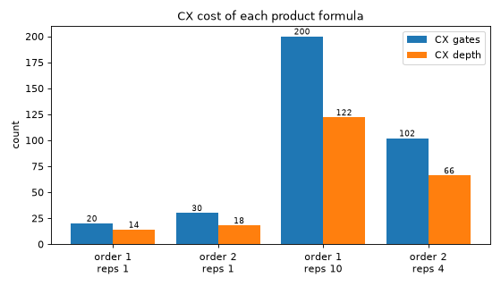

<a id="fermionic-synthesis-explanation"></a>

# Synthesize an Evolution gate in fermionic space

#### IMPORTANT
The concepts in this guide are currently available only in the Python API.
Equivalent functionality will be made available in the C API in a future release.

An [`Evolution`](../stubs/qiskit_fermions.circuit.library.Evolution.html.md#qiskit_fermions.circuit.library.Evolution) gate carries the time evolution $e^{-itH}$ of a whole operator. A
fermion-to-fermion synthesis rewrites that gate into a [`FermionicCircuit`](../stubs/qiskit_fermions.circuit.FermionicCircuit.html.md#qiskit_fermions.circuit.FermionicCircuit) of smaller
fermionic gates. Both sides of the rewrite stay in fermionic space, which is what distinguishes it
from the fermion-to-qubit synthesis that follows: the operator’s
[`groups`](../stubs/qiskit_fermions.operators.OperatorTrait.html.md#qiskit_fermions.operators.OperatorTrait.groups) (see [Group operator terms: use the operator structure](grouping.html.md#grouping-explanation)) survive
it, whereas a fermion-to-qubit mapping returns a
[`SparseObservable`](https://quantum.cloud.ibm.com/docs/api/qiskit/qiskit.quantum_info.SparseObservable), which has no concept of grouping.

Two knobs select the method. `Evolution.synthesis` sets it on one gate, and the
[`F2FSynthesis`](../stubs/qiskit_fermions.transpiler.passes.F2FSynthesis.html.md#qiskit_fermions.transpiler.passes.F2FSynthesis) transpiler pass sets it across a whole circuit. Both take an
[`F2FSynthesisPlugin`](../stubs/qiskit_fermions.circuit.library.synthesis.F2FSynthesisPlugin.html.md#qiskit_fermions.circuit.library.synthesis.F2FSynthesisPlugin), the interface any such rewrite implements. The methods this package
currently provides for an evolution are product formulas, which is what the rest of this guide uses:
[`FermionicLieTrotter`](../stubs/qiskit_fermions.circuit.library.synthesis.FermionicLieTrotter.html.md#qiskit_fermions.circuit.library.synthesis.FermionicLieTrotter) for a first-order formula (the default) and
[`FermionicSuzukiTrotter`](../stubs/qiskit_fermions.circuit.library.synthesis.FermionicSuzukiTrotter.html.md#qiskit_fermions.circuit.library.synthesis.FermionicSuzukiTrotter) for a higher even order. Anything else implementing the interface
is selected the same way, and the sections on the two knobs apply to it unchanged.

#### NOTE
This fermion-to-fermion step is **optional**. An [`Evolution`](../stubs/qiskit_fermions.circuit.library.Evolution.html.md#qiskit_fermions.circuit.library.Evolution) gate can go straight to the
fermion-to-qubit stage, which maps and synthesizes it whole however many terms it holds.
Splitting it first is a choice, made because the resulting gates are individually cheaper or
because the split exposes structure that a later stage can use.

The two steps compose, so an evolution can end up approximated at either level, at both, or at
neither. A product formula approximates unless its factors commute; a synthesis method need not
approximate at all.

#### NOTE
Skipping this step does not have to mean losing the grouping entirely. Wrapping the mapper in
[`group_wise()`](../stubs/qiskit_fermions.transpiler.passes.synthesis.group_wise.html.md#qiskit_fermions.transpiler.passes.synthesis.group_wise) maps the operator one group at a time and sums the results, so the mapped
Pauli terms arrive grouped rather than interleaved. A qubit-side product formula synthesizes them
in the order it receives, so commuting terms that end up adjacent can be scheduled together.

On the Hamiltonian below that recovers the whole two-qubit depth benefit of splitting: 18 instead
of 30, at an unchanged gate count. The difference is *where* the structure is expressed.
Splitting in fermionic space makes each group a separate gate, which every later stage can see
and act on; `group_wise` leaves one gate and only reorders the terms inside it, which is enough
for scheduling but leaves nothing for a fermionic pass to work with. Use it when the evolution
has to stay a single gate, and reach for a fermionic product formula otherwise.

## Build a grouped Hamiltonian

Both product formulas split an operator into factors, and for a grouped operator those factors are
its groups. The grouping is therefore what determines both the cost and the accuracy of the result.
Take a six-site Fermi-Hubbard chain, grouped the way its terms commute: the hopping terms on even
bonds, the hopping terms on odd bonds, and the diagonal interaction.

```pycon
>>> from qiskit_fermions.operators import FermionOperator, cre, ann
>>>
>>> def fermi_hubbard_chain(num_sites, tunneling, interaction):
...     """A 1D Fermi-Hubbard chain grouped into even bonds, odd bonds, and the interaction."""
...     terms, groups = [], []
...     for offset in (0, 1):
...         for j in range(offset, num_sites - 1, 2):
...             terms += [
...                 ([cre(j), ann(j + 1)], -tunneling),
...                 ([cre(j + 1), ann(j)], -tunneling),
...             ]
...             groups += [offset, offset]
...     for j in range(num_sites - 1):
...         terms.append(([cre(j), ann(j), cre(j + 1), ann(j + 1)], interaction))
...         groups.append(2)
...     operator = FermionOperator.from_terms(terms)
...     operator.groups = groups
...     return operator
>>>
>>> num_sites = 6
>>> hamiltonian = fermi_hubbard_chain(num_sites, tunneling=1.0, interaction=2.0)
>>> hamiltonian.num_groups()
3
```

Fifteen terms in three groups. Each hopping group pairs every term with its conjugate partner, which
matters: a factor has to be Hermitian for its exponential to be unitary, and that does not follow
from the sum being Hermitian. [`groups_are_hermitian()`](../stubs/qiskit_fermions.operators.terms.groups_are_hermitian.html.md#qiskit_fermions.operators.terms.groups_are_hermitian) checks that convention rather than
leaving it to inspection:

```pycon
>>> from qiskit_fermions.operators.terms.grouping import groups_are_hermitian
>>>
>>> groups_are_hermitian(hamiltonian)
[True, True, True]
```

Separating $a^\dagger_0 a_1$ from its partner $a^\dagger_1 a_0$ would break it, and
leaving the operator ungrouped has the same effect, since both formulas then split it *term by term*
and a lone $a^\dagger_i a_j$ is not Hermitian:

```pycon
>>> ungrouped = fermi_hubbard_chain(num_sites, tunneling=1.0, interaction=2.0)
>>> ungrouped.groups = range(len(list(ungrouped.iter_terms())))  # one group per term
>>> all(groups_are_hermitian(ungrouped))
False
```

Such a factor is a valid fermionic operator, and this package will build the gate for it, so nothing
complains until the mapped operator reaches
[`PauliEvolutionGate`](https://quantum.cloud.ibm.com/docs/api/qiskit/qiskit.circuit.library.PauliEvolutionGate), which requires real coefficients and raises
`ValueError: Operator contains complex coefficients, which are not supported`. Checking the
grouping up front turns that late failure into an answer available before any circuit is built.

## Set the method on one gate

Pass a synthesis method to the gate, then decompose it. Each gate it emits comes back as its own
[`Evolution`](../stubs/qiskit_fermions.circuit.library.Evolution.html.md#qiskit_fermions.circuit.library.Evolution) gate:

```pycon
>>> from qiskit_fermions.circuit import FermionicCircuit
>>> from qiskit_fermions.circuit.library import Evolution
>>> from qiskit_fermions.circuit.library.synthesis import (
...     FermionicLieTrotter,
...     FermionicSuzukiTrotter,
... )
>>>
>>> total_time = 1.0
>>>
>>> def factors(synthesis):
...     circuit = FermionicCircuit(num_sites)
...     circuit.append(
...         Evolution(num_sites, hamiltonian, time=total_time, synthesis=synthesis),
...         circuit.modes,
...     )
...     return circuit.decompose().count_ops()["Evolution"]
>>>
>>> factors(FermionicLieTrotter())
3
>>> factors(FermionicSuzukiTrotter(order=2))
5
>>> factors(FermionicSuzukiTrotter(order=2, reps=4))
17
>>> factors(FermionicSuzukiTrotter(order=2, reps=4, merge_adjacent=False))
20
```

First order emits one factor per group. Order two emits the symmetric palindrome, so the two outer
groups appear twice at half the time each, giving five. Four repetitions of that would give twenty,
but each repetition ends on the same group the next one begins with. Those neighboring gates
evolve under the same operator, so they are fused into one gate with the summed time, which saves
one gate per seam. Pass `merge_adjacent=False` to keep the textbook sequence. Every order splits
the operator the same way; what changes is the ordering of the factors and their evolution times,
not the partition.

#### NOTE
The factors are marked `atomic`, so decomposing again leaves them in place
rather than splitting them further. The decomposition has a fixed point, which is what makes it
safe to call [`decompose()`](../stubs/qiskit_fermions.circuit.FermionicCircuit.html.md#qiskit_fermions.circuit.FermionicCircuit.decompose) repeatedly.

## Set the method for a whole pipeline

Setting `synthesis` per gate means threading the choice through everything that
builds one, including [`UCC`](../stubs/qiskit_fermions.circuit.library.UCC.html.md#qiskit_fermions.circuit.library.UCC) and [`UCJ`](../stubs/qiskit_fermions.circuit.library.UCJ.html.md#qiskit_fermions.circuit.library.UCJ), which construct their gates internally. The
[`F2FSynthesis`](../stubs/qiskit_fermions.transpiler.passes.F2FSynthesis.html.md#qiskit_fermions.transpiler.passes.F2FSynthesis) pass applies one method to every [`Evolution`](../stubs/qiskit_fermions.circuit.library.Evolution.html.md#qiskit_fermions.circuit.library.Evolution) in a circuit instead, so
the choice is made once for the pipeline. It is configured by gate name, the same way
[`F2QSynthesis`](../stubs/qiskit_fermions.transpiler.passes.F2QSynthesis.html.md#qiskit_fermions.transpiler.passes.F2QSynthesis) is, and a gate that is not named is left as it is:

```pycon
>>> from qiskit_fermions.transpiler import FermionicPassManager
>>> from qiskit_fermions.transpiler.passes import F2FSynthesis
>>>
>>> circuit = FermionicCircuit(num_sites)
>>> circuit.append(Evolution(num_sites, hamiltonian, time=total_time), circuit.modes)
>>>
>>> expanded = FermionicPassManager(
...     F2FSynthesis({"Evolution": ("SuzukiTrotter", (), {"order": 2, "reps": 4})})
... ).run(circuit)
>>> expanded.count_ops()["Evolution"]
17
```

This is the same count [`decompose()`](../stubs/qiskit_fermions.circuit.FermionicCircuit.html.md#qiskit_fermions.circuit.FermionicCircuit.decompose) gives for that method above. The
[`MergeEvolutions`](../stubs/qiskit_fermions.transpiler.passes.MergeEvolutions.html.md#qiskit_fermions.transpiler.passes.MergeEvolutions) pass applies the same fusion to neighboring gates that did not come from
one synthesis, such as the seams between consecutive circuits. The pass carries the formula out
itself, so no separate expansion step is needed, and running it twice changes nothing, since the
factors it emits are `atomic` and so carry no definition of their own.

#### NOTE
Pass `apply=False` to only *select* the method and leave the expansion to something else, such
as Qiskit’s [`Decompose`](https://quantum.cloud.ibm.com/docs/api/qiskit/qiskit.transpiler.passes.Decompose) (naming the gate as
`Decompose("Evolution")` restricts it to the evolutions, leaving the other fermionic gates to
their own synthesis plugins).

This is useful to choose the method for a whole circuit up front while deferring the expansion
to the point where it is wanted, for example to inspect the circuit first:

```pycon
>>> selected = FermionicPassManager(
...     F2FSynthesis({"Evolution": ("SuzukiTrotter", (), {"order": 2})}, apply=False)
... ).run(circuit)
>>> selected.count_ops()["Evolution"]  # selected, not yet expanded
1
>>> selected.decompose().count_ops()["Evolution"]  # expanded on demand
5
```

Be aware of what an unexpanded gate does, though: it reaches the fermion-to-qubit stage whole,
where it is mapped without `synthesis` being consulted. That makes for an easy
mistake when comparing methods, because every one of them then produces identical output and the
comparison silently measures nothing. On the Hamiltonian above, leaving the order-two gate
unexpanded collapses the much larger circuit below to the cost of a single mapped evolution, no
matter which method was selected.

## Measure the payoff

A higher order costs depth, so the question is not whether it is more accurate but whether it is
more accurate *per gate*. Two numbers are needed per method: the error of the state it produces, and
the two-qubit cost of the circuit that produced it.

The error is measured with [ffsim](https://qiskit-community.github.io/ffsim/), which simulates a [`FermionicCircuit`](../stubs/qiskit_fermions.circuit.FermionicCircuit.html.md#qiskit_fermions.circuit.FermionicCircuit) **directly** (see
[How this package relates to ffsim](ffsim.html.md#ffsim-relationship-explanation)). No fermion-to-qubit mapping is involved, so the comparison
isolates the fermionic product formula from anything the mapping or the qubit-side synthesis might
contribute. It also works in the fixed-particle-number sector, which is both smaller than the full
$2^N$ space and the space the evolution actually stays in.

```pycon
>>> import ffsim
>>> import numpy as np
>>> from scipy.sparse.linalg import expm_multiply
>>> from qiskit_fermions.transpiler.presets import generate_preset_jw_pass_manager
>>>
>>> norb, nelec = num_sites, (3, 0)  # three spinless fermions on six modes
>>> initial = ffsim.hartree_fock_state(norb, nelec)
>>>
>>> hamiltonian_operator = ffsim.linear_operator(hamiltonian, norb=norb, nelec=nelec)
>>> exact = expm_multiply(
...     -1j * total_time * hamiltonian_operator,
...     initial,
...     traceA=-1j * total_time * ffsim.trace(hamiltonian, norb=norb, nelec=nelec),
... )
>>>
>>> def cost_and_error(synthesis):
...     circuit = FermionicCircuit(num_sites)
...     circuit.append(
...         Evolution(num_sites, hamiltonian, time=total_time, synthesis=synthesis),
...         circuit.modes,
...     )
...     # the method is set on the gate, so decompose() is what expands it here; a pipeline
...     # would reach for F2FSynthesis instead (see the note above)
...     circuit = circuit.decompose()
...     evolved = ffsim.apply_unitary(initial, circuit, norb=norb, nelec=nelec)
...     error = 1 - abs(np.vdot(evolved, exact)) ** 2
...     qubit_circuit = generate_preset_jw_pass_manager().run(circuit).decompose(reps=6)
...     two_qubit = lambda instruction: len(instruction.qubits) == 2
...     return error, qubit_circuit.count_ops()["cx"], qubit_circuit.depth(two_qubit)
>>>
>>> methods = [
...     ("order 1, reps 1 ", FermionicLieTrotter()),
...     ("order 2, reps 1 ", FermionicSuzukiTrotter(order=2)),
...     ("order 1, reps 10", FermionicLieTrotter(reps=10)),
...     ("order 2, reps 4 ", FermionicSuzukiTrotter(order=2, reps=4)),
... ]
>>> costs = {label: cost_and_error(synthesis) for label, synthesis in methods}
>>> labels, counts, depths = [], [], []
>>> for label, (error, gates, depth) in costs.items():
...     labels.append(label.strip().replace(", ", "\n"))
...     counts.append(gates)
...     depths.append(depth)
...     print(f"{label}  error {error:.6f}")
order 1, reps 1   error 0.515997
order 2, reps 1   error 0.180958
order 1, reps 10  error 0.004026
order 2, reps 4   error 0.000421
```

The two-qubit cost is left out of that table on purpose. It depends on the qubit-side synthesis
Qiskit selects, which improves between releases, so the numbers printed here would be a snapshot
rather than a property of the product formula. The figure below plots them instead, and what the
comparison rests on is asserted as a relation:

([`png`](_downloads/b46ec933dbb85823f1f5be6bd7d087bd/fermionic_synthesis-8.png), [`hires.png`](_downloads/36cc1f320b26faf511b580a07f07bb73/fermionic_synthesis-8.hires.png), [`pdf`](_downloads/fe86afaca28f8ed621a0840ada548368/fermionic_synthesis-8.pdf))



Read the last two methods together, because they are the comparison that matters. Order two with
four repetitions is roughly ten times more accurate than order one with ten, and it gets there with
fewer entangling gates rather than more, as the figure shows. Spending a gate budget on a higher
order beats spending it on more first-order steps here.

That result is not universal. Increasing [`reps`](../stubs/qiskit_fermions.circuit.library.synthesis.FermionicSuzukiTrotter.html.md#qiskit_fermions.circuit.library.synthesis.FermionicSuzukiTrotter.reps) and increasing
[`order`](../stubs/qiskit_fermions.circuit.library.synthesis.FermionicSuzukiTrotter.html.md#qiskit_fermions.circuit.library.synthesis.FermionicSuzukiTrotter.order) reduce the error at different rates for the same kind of
cost, and which wins depends on the operator and on the time being evolved. The two rows above are
how to find out for a given problem.

#### NOTE
The fermionic formula composes with the one chosen for the fermion-to-qubit stage (see
[`MapperFnEvolutionSynthesis.product_formula`](../stubs/qiskit_fermions.transpiler.passes.synthesis.MapperFnEvolutionSynthesis.html.md#qiskit_fermions.transpiler.passes.synthesis.MapperFnEvolutionSynthesis.product_formula)). Where both approximate, the accuracy of the
result is governed by the weaker of the two, so raising the order here while the qubit-side
formula stays first-order buys little.

## Restrict the pass to the gates that benefit

A higher order only helps when the factors do not commute. If they all commute, the first-order
formula is already exact and the extra factors are pure overhead. A purely diagonal operator makes
that concrete, since number operators commute with each other:

```pycon
>>> from qiskit_fermions.transpiler.presets import generate_preset_jw_pass_manager
>>>
>>> diagonal = FermionOperator.from_terms(
...     [([cre(j), ann(j), cre(j + 1), ann(j + 1)], 1.0 + 0.1 * j) for j in range(num_sites - 1)]
... )
>>> diagonal.groups = list(range(num_sites - 1))
>>>
>>> def diagonal_cost(synthesis):
...     circuit = FermionicCircuit(num_sites)
...     circuit.append(
...         Evolution(num_sites, diagonal, time=total_time, synthesis=synthesis), circuit.modes
...     )
...     transpiled = generate_preset_jw_pass_manager().run(circuit.decompose())
...     return transpiled.decompose(reps=6).count_ops()["cx"]
>>>
>>> diagonal_cost(FermionicLieTrotter())
10
>>> diagonal_cost(FermionicSuzukiTrotter(order=2))
18
```

Both circuits are exact, so the second spends 80% more entangling gates for nothing. The diagonal
Coulomb operators of a [`UCJ`](../stubs/qiskit_fermions.circuit.library.UCJ.html.md#qiskit_fermions.circuit.library.UCJ) have this shape, which is why
[`F2FSynthesis.filter`](../stubs/qiskit_fermions.transpiler.passes.F2FSynthesis.html.md#qiskit_fermions.transpiler.passes.F2FSynthesis.filter) exists: it takes a predicate over the
[`DAGOpNode`](https://quantum.cloud.ibm.com/docs/api/qiskit/qiskit.dagcircuit.DAGOpNode) and leaves the rejected gates untouched, so one pass can raise
the order on the gates that benefit and leave the rest at first order.

A circuit holding both kinds of evolution shows what that saves. The predicate below accepts a gate
only when its operator moves particles between modes, which is exactly when the groups fail to
commute and a higher order has something to buy:

```pycon
>>> def is_diagonal(operator):
...     """Whether every term only counts particles, rather than moving them between modes."""
...     return all(
...         sorted(mode for created, mode in actions if created)
...         == sorted(mode for created, mode in actions if not created)
...         for actions, _ in operator.iter_terms()
...     )
>>>
>>> def mixed_circuit():
...     circuit = FermionicCircuit(num_sites)
...     circuit.append(Evolution(num_sites, hamiltonian, time=total_time), circuit.modes)
...     circuit.append(Evolution(num_sites, diagonal, time=total_time), circuit.modes)
...     return circuit
>>>
>>> def two_qubit_cost(circuit):
...     transpiled = generate_preset_jw_pass_manager().run(circuit).decompose(reps=6)
...     two_qubit = lambda instruction: len(instruction.qubits) == 2
...     return transpiled.count_ops()["cx"], transpiled.depth(two_qubit)
>>>
>>> order_2 = FermionicSuzukiTrotter(order=2)
>>>
>>> everywhere = two_qubit_cost(
...     FermionicPassManager(F2FSynthesis({"Evolution": order_2})).run(mixed_circuit())
... )
>>> restricted = two_qubit_cost(
...     FermionicPassManager(
...         F2FSynthesis(
...             {"Evolution": order_2}, filter=lambda node: not is_diagonal(node.op.operator)
...         )
...     ).run(mixed_circuit())
... )
>>> everywhere[0] - restricted[0]  # the gates the filter saved
8
>>> restricted[0] < everywhere[0] and restricted[1] < everywhere[1]
True
```

The gates the filter saves are exactly the ones order two spent on the diagonal evolution, which the
diagonal comparison above prices at eight (18 against 10). They bought nothing there, because that
evolution is already exact at first order, so dropping them costs no accuracy.

#### NOTE
Compare the two order-two circuits with each other, not against the unexpanded one. Leaving both
gates unexpanded sends each to the fermion-to-qubit stage whole, which is the mistake the
`apply=False` note above describes: it can land on the same entangling-gate count as the
filtered circuit while being a different circuit at a different depth, so reading the filter’s
benefit off that number measures nothing.

#### CAUTION
Neither knob verifies that the factors are Hermitian, and an incorrectly grouped operator can
look *better* at an even order than at first order while still being wrong, because the
symmetrization partially cancels the error. Group conjugate partners together, as
`fermi_hubbard_chain` above does.

## Next steps

- Read [Group operator terms: use the operator structure](grouping.html.md#grouping-explanation) for how the groups these product formulas split on are assigned.
- Read [Transpile fermionic circuits](transpilation.html.md#transpilation-explanation) for the stages a [`FermionicCircuit`](../stubs/qiskit_fermions.circuit.FermionicCircuit.html.md#qiskit_fermions.circuit.FermionicCircuit) passes through.
- See [Simulate 1D Fermi-Hubbard dynamics with flow sets](1d_fermi_hubbard.html.md#d-fermi-hubbard) for a worked case where the fermionic formula supplies the step count
  that a custom qubit-side synthesis cannot.
- Consult [`synthesis`](../pydoc/qiskit_fermions.circuit.library.synthesis.html.md#module-qiskit_fermions.circuit.library.synthesis) for the synthesis methods themselves,
  and [`FermionicQDrift`](../stubs/qiskit_fermions.circuit.library.synthesis.FermionicQDrift.html.md#qiskit_fermions.circuit.library.synthesis.FermionicQDrift) for a randomized alternative.
