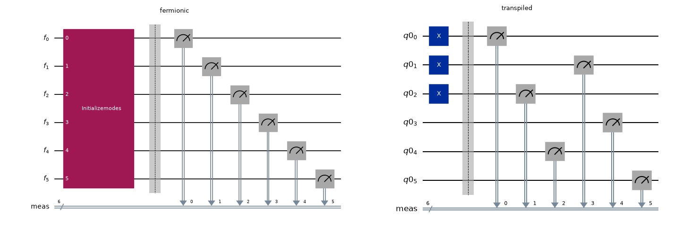

# RelabelModes

### *class* RelabelModes(permutation=None, , solver=None, \*\*kwargs)

A transpilation pass to relabel the fermionic modes.

Bases: [`GenericPass`](https://quantum.cloud.ibm.com/docs/api/qiskit/qiskit.passmanager.GenericPass)[[`DAGCircuit`](https://quantum.cloud.ibm.com/docs/api/qiskit/qiskit.dagcircuit.DAGCircuit), [`DAGCircuit`](https://quantum.cloud.ibm.com/docs/api/qiskit/qiskit.dagcircuit.DAGCircuit)]

This pass reorders the fermionic modes of a circuit. The reordering is described by a
`permutation` list, read as a mapping from *original* to *new* mode index: original mode `i`
is placed at new index `permutation[i]` in the relabeled circuit. For example,
`permutation = [0, 2, 4, 1, 3, 5]` places original mode `1` at new index `2`, original
mode `2` at new index `4`, and so on. Being a permutation, each index must appear exactly
once.

### Post-processing

The relabeling reorders the fermionic modes, which in turn influences the fermion-to-qubit
mapping chosen by a later synthesis stage (and thus the achievable circuit depth). How much work
that costs you when interpreting sampled bitstrings depends on *where* you add the measurements.

The simplest option is to measure on the [`FermionicCircuit`](qiskit_fermions.circuit.FermionicCircuit.html.md#qiskit_fermions.circuit.FermionicCircuit), with
[`FermionicCircuit.measure_all()`](qiskit_fermions.circuit.FermionicCircuit.html.md#qiskit_fermions.circuit.FermionicCircuit.measure_all), before transpiling. Each measurement then names the mode it
reads and the classical bit it writes into, and both travel through this pass together: the mode is
relabeled, the classical bit is not. The sampled bitstring is therefore indexed by the *original*
mode and needs **no post-processing at all**:

```pycon
>>> from qiskit.passmanager import MultiStagePassManager
>>> from qiskit.providers.basic_provider import BasicSimulator
>>> from qiskit_fermions.circuit import FermionicCircuit
>>> from qiskit_fermions.circuit.library import InitializeModes
>>> from qiskit_fermions.transpiler import FermionicCircuitToDAG, QuantumDAGToCircuit
>>> from qiskit_fermions.transpiler.passes import (
...     F2QSynthesis, F2QSynthesisPluginManager, RelabelModes, TrivialF2QLayout,
... )
>>>
>>> # blocked occupation: spin-up orbitals 0 and 1 and spin-down orbital 0 are occupied
>>> circ = FermionicCircuit(6)
>>> circ.append(InitializeModes([1, 1, 0, 1, 0, 0]), circ.modes)
>>> circ.barrier()
>>> circ.measure_all()  # measure the *fermionic* circuit
>>>
>>> synth_plugins = F2QSynthesisPluginManager()
>>> synth = F2QSynthesis()
>>> synth.methods["InitializeModes"] = synth_plugins.method("InitializeModes", "TrivialOccupation")()
>>> synth.methods["FermionicMeasure"] = synth_plugins.method("FermionicMeasure", "TrivialOccupation")()
>>>
>>> pm = MultiStagePassManager(
...     init=FermionicCircuitToDAG(),
...     optimization=RelabelModes(permutation=[0, 2, 4, 1, 3, 5]),
...     layout=TrivialF2QLayout(),
...     synthesis=synth,
...     output=QuantumDAGToCircuit(),
... )
>>>
>>> qcirc = pm.run(circ)
>>>
>>> counts = BasicSimulator().run(qcirc, shots=1).result().get_counts()
>>> print(counts)  # already in the original blocked ordering
{'001011': 1}
```

Drawing the two circuits side by side shows what travelled and what did not. The fermionic
measurements read modes `0..5` in order; after synthesis they sit on permuted qubits, yet each one
still writes into the classical bit of the mode it measures, so the `meas` labels remain in the
original order:

([`png`](_downloads/54d61cc08494784415151da11c267454/qiskit_fermions-transpiler-passes-RelabelModes-2.png), [`hires.png`](_downloads/2a1569ea04412a9923173a1178c7f2ac/qiskit_fermions-transpiler-passes-RelabelModes-2.hires.png), [`pdf`](_downloads/cad8daf08a377c385fa6c9d7fe1895e3/qiskit_fermions-transpiler-passes-RelabelModes-2.pdf))



Measuring the transpiled [`QuantumCircuit`](https://quantum.cloud.ibm.com/docs/api/qiskit/qiskit.circuit.QuantumCircuit) instead leaves you to undo the
relabeling yourself, because those measurements were never part of the fermionic circuit and so
know nothing about it. The relabeling that was actually applied is recorded in a `permutation`
field of the returned [`FermionicDAGCircuit`](qiskit_fermions.circuit.FermionicDAGCircuit.html.md#qiskit_fermions.circuit.FermionicDAGCircuit)’s
[`metadata`](https://quantum.cloud.ibm.com/docs/api/qiskit/qiskit.dagcircuit.DAGCircuit#metadata).

#### IMPORTANT
Always read the relabeling from the circuit metadata rather than from [`permutation`](#qiskit_fermions.transpiler.passes.RelabelModes.permutation).
When the automatic optimization is used (i.e. [`permutation`](#qiskit_fermions.transpiler.passes.RelabelModes.permutation) is `None`), the applied
permutation is only available from the metadata; and even when [`permutation`](#qiskit_fermions.transpiler.passes.RelabelModes.permutation) was
provided explicitly, the metadata is guaranteed to reflect what the pass did.

Note that the `permutation` metadata field is only present when the pass actually relabeled
the circuit. When the pass has no effect – for example, when the automatic optimization
cannot run because the optional `pyomo` dependency or a [`solver`](#qiskit_fermions.transpiler.passes.RelabelModes.solver) is missing – the
returned circuit is unchanged and carries no `permutation` metadata, so access it defensively
(e.g. `qcirc.metadata.get("permutation")`).

Conceptually, undoing the relabeling assigns to each original mode `m` the value that was
measured for new mode `permutation[m]`. In practice this is complicated by the fact that
[`FermionicRegister`](qiskit_fermions.circuit.FermionicRegister.html.md#qiskit_fermions.circuit.FermionicRegister) modes and Qiskit’s classical bits run in opposite (little-endian)
order, so the mode-space gather turns into an index negation (`~idx`) followed by a final
reversal (`[::-1]`) on the counts bitstrings.

The example below repeats the six-mode relabeling above, from a blocked spin ordering
(`[u0, u1, u2, d0, d1, d2]`) to an interleaved one (`[u0, d0, u1, d1, u2, d2]`) as a common
trick to reduce the implementation depth, but measures after transpilation, and so has to undo
the relabeling on the sampled counts:

```pycon
>>> from qiskit.passmanager import MultiStagePassManager
>>> from qiskit.providers.basic_provider import BasicSimulator
>>> from qiskit_fermions.circuit import FermionicCircuit
>>> from qiskit_fermions.circuit.library import InitializeModes
>>> from qiskit_fermions.transpiler import FermionicCircuitToDAG, QuantumDAGToCircuit
>>> from qiskit_fermions.transpiler.passes import (
...     F2QSynthesis, F2QSynthesisPluginManager, RelabelModes, TrivialF2QLayout,
... )
>>>
>>> # blocked occupation: spin-up orbitals 0 and 1 and spin-down orbital 0 are occupied
>>> circ = FermionicCircuit(6)
>>> circ.append(InitializeModes([1, 1, 0, 1, 0, 0]), circ.modes)
>>>
>>> synth_plugins = F2QSynthesisPluginManager()
>>> synth = F2QSynthesis()
>>> synth.methods["InitializeModes"] = synth_plugins.method("InitializeModes", "TrivialOccupation")()
>>>
>>> # map blocked mode order onto the interleaved one
>>> relabel = RelabelModes(permutation=[0, 2, 4, 1, 3, 5])
>>>
>>> pm = MultiStagePassManager(
...     init=FermionicCircuitToDAG(),
...     optimization=relabel,
...     layout=TrivialF2QLayout(),
...     synthesis=synth,
...     output=QuantumDAGToCircuit(),
... )
>>>
>>> qcirc = pm.run(circ)
>>> qcirc.measure_all()
>>>
>>> bit_permutation = qcirc.metadata.get("permutation")
>>> print(bit_permutation)
[0, 2, 4, 1, 3, 5]
>>>
>>> res = BasicSimulator().run(qcirc, shots=1).result()
>>> counts = res.get_counts()
>>> print(counts)  # measured in the interleaved ordering
{'000111': 1}
>>>
>>> # undo the relabeling to recover the counts in the original blocked ordering
>>> post_processed = {
...     "".join(bitstring[~idx] for idx in bit_permutation)[::-1]: count
...     for bitstring, count in counts.items()
... }
>>> print(post_processed)  # recovered in the original blocked ordering
{'001011': 1}
```

Initializing this transpiler pass can be done with the arguments listed below.

* **Parameters:**
  * **permutation** ([*list*](https://docs.python.org/3/builtins/stdtypes.html#list) *[*[*int*](https://docs.python.org/3/builtins/functions.html#int) *]*  *|* *None*) – the index permutation used to relabel the fermionic mode indices. When this
    is `None`, a permutation will be determined automatically based on
    [`build_excitation_span_minimization_model()`](qiskit_fermions.mappers.optimization.build_excitation_span_minimization_model.html.md#qiskit_fermions.mappers.optimization.build_excitation_span_minimization_model). See also [`permutation`](#qiskit_fermions.transpiler.passes.RelabelModes.permutation) for
    more details.
  * **solver** (*pyomo.opt.SolverFactory* *|* *None*) – the optimization problem solver instance used to solve the
    [`build_excitation_span_minimization_model()`](qiskit_fermions.mappers.optimization.build_excitation_span_minimization_model.html.md#qiskit_fermions.mappers.optimization.build_excitation_span_minimization_model) problem. When this is `None`, no
    `permutation` can be determined automatically. See also [`solver`](#qiskit_fermions.transpiler.passes.RelabelModes.solver) for more
    details.
  * **kwargs** – any additional keyword arguments will be forward to
    [`build_excitation_span_minimization_model()`](qiskit_fermions.mappers.optimization.build_excitation_span_minimization_model.html.md#qiskit_fermions.mappers.optimization.build_excitation_span_minimization_model).

### Attributes

#### permutation

The index permutation used to relabel the fermionic mode indices.

This may either be a `list[int]`, mapping original mode index `i` to new mode index
`permutation[i]` (see the class docstring for details). Its length has to match the number
of fermionic modes of the circuit being transpiled, and each index has to appear exactly
once. This scenario therefore requires the transpiler pass to be tailored quite specifically
to the user’s circuit.

Or it may be `None`, in which case the [`build_excitation_span_minimization_model()`](qiskit_fermions.mappers.optimization.build_excitation_span_minimization_model.html.md#qiskit_fermions.mappers.optimization.build_excitation_span_minimization_model)
function is used to define an optimization problem which tries to minimize the span of all
occurring fermionic excitations. In this case the applied permutation is only available from
the transpiled circuit’s metadata (see the class docstring).

#### NOTE
The use of this optimization model is only implemented for time evolution gates
containing a [`FermionOperator`](qiskit_fermions.operators.FermionOperator.html.md#qiskit_fermions.operators.FermionOperator) instance.

#### solver

The optimization problem solver instance to automatically find [`permutation`](#qiskit_fermions.transpiler.passes.RelabelModes.permutation).

When [`permutation`](#qiskit_fermions.transpiler.passes.RelabelModes.permutation) is `None`, the optimization problem defined by
[`build_excitation_span_minimization_model()`](qiskit_fermions.mappers.optimization.build_excitation_span_minimization_model.html.md#qiskit_fermions.mappers.optimization.build_excitation_span_minimization_model) is used to automatically find a good
permutation of mode indices. In such a case, the user must provide an optimizer to solve
this model.

### Methods

#### find_permutation(dag)

Finds a mode index [`permutation`](#qiskit_fermions.transpiler.passes.RelabelModes.permutation) when not specified by the user.

This function only gets called when [`permutation`](#qiskit_fermions.transpiler.passes.RelabelModes.permutation) is not specified by the user (i.e.
it is `None`). When that is the case, it does the following:

1. ensure that the optional [pyomo](https://pypi.org/project/pyomo/) dependency is
   installed. Otherwise, no optimization can be performed and this transpiler pass has no
   effect.
2. ensure that a [`solver`](#qiskit_fermions.transpiler.passes.RelabelModes.solver) is specified. Otherwise, no optimization can be performed
   and this transpiler pass has no effect.
3. gather all the fermionic excitations from any [`Evolution`](qiskit_fermions.circuit.library.Evolution.html.md#qiskit_fermions.circuit.library.Evolution) gates containing a
   [`FermionOperator`](qiskit_fermions.operators.FermionOperator.html.md#qiskit_fermions.operators.FermionOperator) instance.
4. build the optimization problem using [`build_excitation_span_minimization_model()`](qiskit_fermions.mappers.optimization.build_excitation_span_minimization_model.html.md#qiskit_fermions.mappers.optimization.build_excitation_span_minimization_model),
   forwarding any additional keyword arguments (`kwargs`) from when this transpiler pass
   was constructed.
5. solve the optimization problem using [`solver`](#qiskit_fermions.transpiler.passes.RelabelModes.solver) and extract the final permutation.

* **Parameters:**
  **dag** ([*FermionicDAGCircuit*](qiskit_fermions.circuit.FermionicDAGCircuit.html.md#qiskit_fermions.circuit.FermionicDAGCircuit)) – the circuit to be transpiled.
* **Returns:**
  The permutation to use. When `None`, this transpiler pass will have no effect.
* **Raises:**
  [**NotImplementedError**](https://docs.python.org/3/builtins/exceptions.html#NotImplementedError) – when encountering an [`Evolution`](qiskit_fermions.circuit.library.Evolution.html.md#qiskit_fermions.circuit.library.Evolution) gate containing an
      operator that is not a [`FermionOperator`](qiskit_fermions.operators.FermionOperator.html.md#qiskit_fermions.operators.FermionOperator) instance.
* **Return type:**
  [tuple](https://docs.python.org/3/builtins/stdtypes.html#tuple)[[list](https://docs.python.org/3/builtins/stdtypes.html#list)[[int](https://docs.python.org/3/builtins/functions.html#int)] | None, [pyomo.opt.results.results_.SolverResults](https://pyomo.readthedocs.io/en/stable/api/pyomo.opt.results.results_.SolverResults.html#pyomo.opt.results.results_.SolverResults) | None]

#### run(dag)

Runs this transpilation pass.

* **Parameters:**
  **dag** ([*DAGCircuit*](https://quantum.cloud.ibm.com/docs/api/qiskit/qiskit.dagcircuit.DAGCircuit)) – the input circuit with fermion-based instructions. Only
  [`DAGOpNode`](https://quantum.cloud.ibm.com/docs/api/qiskit/qiskit.dagcircuit.DAGOpNode) with [`FermionicGate`](qiskit_fermions.circuit.FermionicGate.html.md#qiskit_fermions.circuit.FermionicGate) instances as their
  [`op`](https://quantum.cloud.ibm.com/docs/api/qiskit/qiskit.dagcircuit.DAGOpNode#op) are supported, plus
  `Barrier` and [`FermionicMeasure`](qiskit_fermions.circuit.library.FermionicMeasure.html.md#qiskit_fermions.circuit.library.FermionicMeasure), which are
  carried through untouched (a measurement keeps the classical bit it writes into).
* **Returns:**
  The output circuit which is still acting on a fermionic register.
* **Raises:**
  [**NotImplementedError**](https://docs.python.org/3/builtins/exceptions.html#NotImplementedError) – when the provided input circuit has more than a single register.
* **Return type:**
  [*DAGCircuit*](https://quantum.cloud.ibm.com/docs/api/qiskit/qiskit.dagcircuit.DAGCircuit)

### Inherited Methods

#### execute(passmanager_ir, state, callback=None)

Execute optimization task for input Qiskit IR.

* **Parameters:**
  * **passmanager_ir** (*IR*) – Qiskit IR to optimize.
  * **state** ([*PassManagerState*](https://quantum.cloud.ibm.com/docs/api/qiskit/qiskit.passmanager.PassManagerState)) – State associated with workflow execution by the pass manager itself.
  * **callback** ([*Callable*](https://docs.python.org/3/library/collections.abc.html#collections.abc.Callable) *[* *[*[*Task*](https://quantum.cloud.ibm.com/docs/api/qiskit/qiskit.passmanager.Task) *,* *IR_OUT* *,* [*PropertySet*](https://quantum.cloud.ibm.com/docs/api/qiskit/qiskit.passmanager.PropertySet) *,* [*float*](https://docs.python.org/3/builtins/functions.html#float) *,* [*int*](https://docs.python.org/3/builtins/functions.html#int) *]* *,* *None* *]*  *|* *None*) – A callback function which is called per execution of optimization task.
* **Returns:**
  Optimized Qiskit IR and state of the workflow.
* **Return type:**
  [tuple](https://docs.python.org/3/builtins/stdtypes.html#tuple)[*IR_OUT*, [*PassManagerState*](https://quantum.cloud.ibm.com/docs/api/qiskit/qiskit.passmanager.PassManagerState)]

#### name()

Name of the pass.

* **Return type:**
  [str](https://docs.python.org/3/builtins/stdtypes.html#str)

#### update_status(state, run_state)

Update workflow status.

* **Parameters:**
  * **state** ([*PassManagerState*](https://quantum.cloud.ibm.com/docs/api/qiskit/qiskit.passmanager.PassManagerState)) – Pass manager state to update.
  * **run_state** (*RunState*) – Completion status of current task.
* **Returns:**
  Updated pass manager state.
* **Return type:**
  [*PassManagerState*](https://quantum.cloud.ibm.com/docs/api/qiskit/qiskit.passmanager.PassManagerState)
