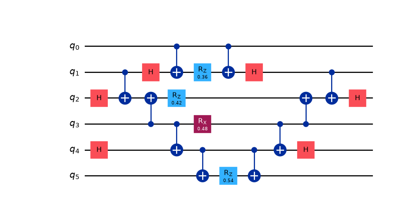
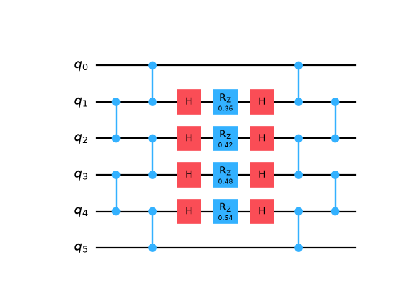
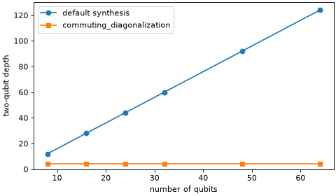
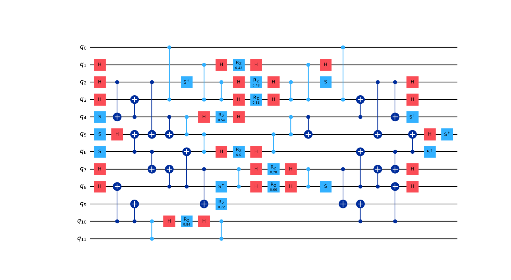
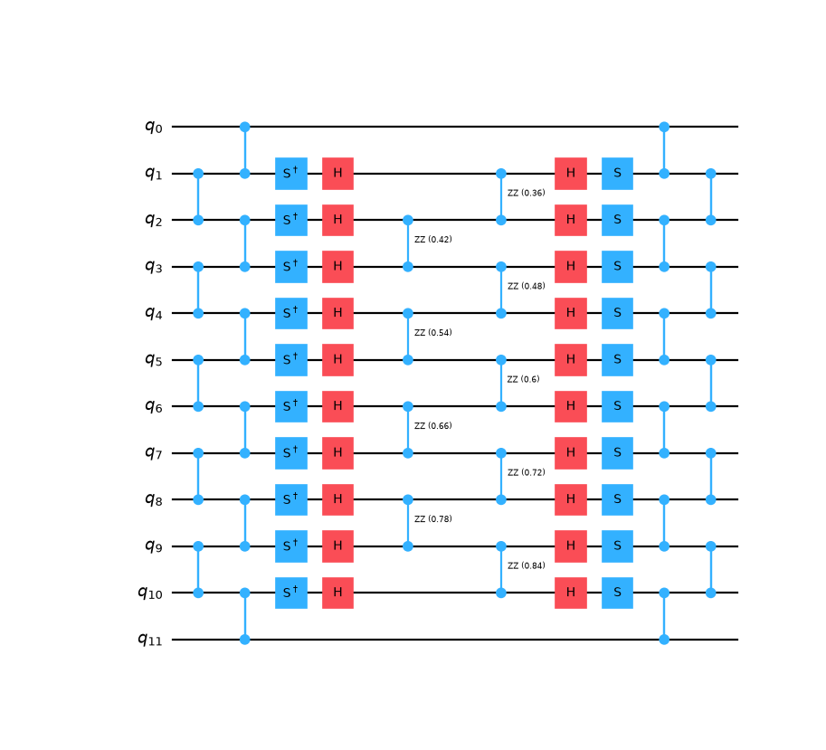

<a id="commuting-evolution-explanation"></a>

# Synthesize the evolution under commuting Pauli terms

#### IMPORTANT
The concepts in this guide are currently available only in the Python API.

When all the Pauli terms of a Hamiltonian $H$ commute with each other, its evolution is
exactly

$$
e^{-itH} = U^\dagger e^{-itM} U,
$$

with a Clifford circuit $U$ and a middle part $M$ that is cheap to synthesize: a
diagonal, or a layer of generic two-qubit blocks next to a diagonal. A term-by-term product
formula ignores this and spends a change of basis on every term. The
[`CommutingDiagonalizationSynthesis`](../stubs/qiskit_fermions.transpiler.passes.synthesis.commuting_evolution.CommutingDiagonalizationSynthesis.html.md#qiskit_fermions.transpiler.passes.synthesis.commuting_evolution.CommutingDiagonalizationSynthesis)
plugin instead builds several such circuits for every
[`PauliEvolutionGate`](https://quantum.cloud.ibm.com/docs/api/qiskit/qiskit.circuit.library.PauliEvolutionGate) of commuting terms, and keeps the cheapest. It
looks only at the Pauli terms, so it needs no knowledge of the model or of the fermion encoding
that produced them.

Groups of commuting terms arise wherever a Hamiltonian is split before it is synthesized: by a
grouping of its terms (see [Group operator terms: use the operator structure](grouping.html.md#grouping-explanation)), and by a product formula in fermionic
space that evolves one group at a time (see [Synthesize an Evolution gate in fermionic space](fermionic_synthesis.html.md#fermionic-synthesis-explanation)). The
[1D](1d_fermi_hubbard.html.md#d-fermi-hubbard) and [2D](2d_fermi_hubbard.html.md#d-fermi-hubbard) Fermi-Hubbard guides use the plugin
for such groups in a complete pipeline. This guide shows the plugin on its own.

## Select the plugin by name

The plugin is a Qiskit
[`HighLevelSynthesisPlugin`](https://quantum.cloud.ibm.com/docs/api/qiskit/qiskit.transpiler.passes.synthesis.plugin.HighLevelSynthesisPlugin) registered as
`"commuting_diagonalization"`. The groups in this section hold the backward hops of a chain
under the encoding of the 1D Fermi-Hubbard guide, a `Z X Z` on every window of three qubits. Any
two of them commute:

```pycon
>>> from qiskit import QuantumCircuit
>>> from qiskit.circuit.library import PauliEvolutionGate
>>> from qiskit.quantum_info import SparsePauliOp
>>>
>>> def zxz_windows(num_qubits):
...     """A circuit with the evolution under a Z X Z on every window of three qubits."""
...     terms = [("ZXZ", [k - 1, k, k + 1], 0.5 + 0.1 * k) for k in range(1, num_qubits - 1)]
...     operator = SparsePauliOp.from_sparse_list(terms, num_qubits=num_qubits)
...     circuit = QuantumCircuit(num_qubits)
...     _ = circuit.append(PauliEvolutionGate(operator, time=0.3), range(num_qubits))
...     return circuit
```

Running only the high-level synthesis shows how a gate is built, before any translation into a
basis. Without any configuration, it uses Qiskit’s default synthesis for the gate:

```pycon
>>> from qiskit.transpiler.passes import HighLevelSynthesis
>>>
>>> HighLevelSynthesis()(zxz_windows(6)).draw("mpl", fold=-1)
<Figure size ... with 1 Axes>
```

([`png`](_downloads/722333338b8fee18165e66882be06216/commuting_evolution-2.png), [`hires.png`](_downloads/c6c6a009dc9551a76481013ae969e201/commuting_evolution-2.hires.png), [`pdf`](_downloads/1d3274d27130f82161954a0a3971434c/commuting_evolution-2.pdf))



The default synthesis treats the windows as a sequence of terms. Neighboring windows overlap, so
their two-qubit gates form one staircase along the chain, and a longer chain needs a longer
staircase.

To use the plugin instead, name it in an
[`HLSConfig`](https://quantum.cloud.ibm.com/docs/api/qiskit/qiskit.transpiler.passes.HLSConfig), with Qiskit’s
default method as a fallback for the gates it declines:

```pycon
>>> from qiskit.transpiler.passes.synthesis.high_level_synthesis import HLSConfig
>>>
>>> plugin_config = HLSConfig(PauliEvolution=["commuting_diagonalization", "default"])
>>> synthesized = HighLevelSynthesis(hls_config=plugin_config)(zxz_windows(6))
>>> synthesized.draw("mpl")
<Figure size ... with 1 Axes>
```

([`png`](_downloads/0f2dae7372f8b5e9e73b592b414020cd/commuting_evolution-3.png), [`hires.png`](_downloads/1efd04fa2de66ce5b0ae1c15cc276c36/commuting_evolution-3.hires.png), [`pdf`](_downloads/d6358dd7baa73d3624eae0999a6bea9f/commuting_evolution-3.pdf))



The two CZ layers on the left are the Clifford $U$. They turn every window into an `X` on
its middle qubit, which the H gates turn into a `Z`, so the middle part is one Rz rotation per
term, all of them in parallel. The mirrored layers on the right undo $U$.

That one Clifford serves every window, however long the chain, so the plugin’s circuit keeps the
same two-qubit depth while the default synthesis grows with the chain. Transpiling both into a CZ
basis for chains of growing length shows the difference:

```pycon
>>> import matplotlib.pyplot as plt
>>> from qiskit.transpiler import generate_preset_pass_manager
>>>
>>> def two_qubit_depth(circuit):
...     return circuit.depth(lambda instruction: len(instruction.qubits) == 2)
>>>
>>> def transpile(circuit, hls_config=None, **options):
...     pass_manager = generate_preset_pass_manager(
...         optimization_level=1,
...         basis_gates=["cz", "rz", "sx", "x"],
...         hls_config=hls_config,
...         seed_transpiler=1,
...         **options,
...     )
...     return pass_manager.run(circuit)
>>>
>>> sizes = [8, 16, 24, 32, 48, 64]
>>> default_depths = [two_qubit_depth(transpile(zxz_windows(n))) for n in sizes]
>>> plugin_depths = [two_qubit_depth(transpile(zxz_windows(n), plugin_config)) for n in sizes]
>>>
>>> figure, axes = plt.subplots(figsize=(6, 3.5), layout="constrained")
>>> _ = axes.plot(sizes, default_depths, "o-", label="default synthesis")
>>> _ = axes.plot(sizes, plugin_depths, "s-", label="commuting_diagonalization")
>>> _ = axes.set(xlabel="number of qubits", ylabel="two-qubit depth", ylim=(0, None))
>>> _ = axes.legend()
>>> figure
<Figure size ... with 1 Axes>
```

([`png`](_downloads/41645e045e98c62eb82713ccc3e791bd/commuting_evolution-4.png), [`hires.png`](_downloads/40e962c1853987f0126f15846ee86900/commuting_evolution-4.hires.png), [`pdf`](_downloads/75ea6b3563be6bd71f87d5e57476a9dc/commuting_evolution-4.pdf))



The plugin handles a gate only if all of its terms commute. It declines any other gate, so the
next method of the [`HLSConfig`](https://quantum.cloud.ibm.com/docs/api/qiskit/qiskit.transpiler.passes.HLSConfig)
synthesizes it, and it never groups terms itself: a gate per commuting group is the input it
expects.

## See which circuit the plugin chose

Every way the plugin builds a circuit is a *candidate*, and a candidate can offer several
*variants* of its circuit. A *selector* then chooses one variant among all of them; the default
one ranks them by two-qubit depth, then two-qubit gate count.

The Z X Z windows are an easy case, for which the candidates that share one Clifford all find
equally good circuits. The `Z X X Z` windows of four qubits, the backward hops of a chain whose
spin orbitals are interleaved, are harder, and set the candidates apart:

```pycon
>>> def zxxz_windows(num_qubits):
...     """A circuit with the evolution under a Z X X Z on every window of four qubits."""
...     terms = [
...         ("ZXXZ", [k - 1, k, k + 1, k + 2], 0.5 + 0.1 * k) for k in range(1, num_qubits - 2)
...     ]
...     operator = SparsePauliOp.from_sparse_list(terms, num_qubits=num_qubits)
...     circuit = QuantumCircuit(num_qubits)
...     _ = circuit.append(PauliEvolutionGate(operator, time=0.3), range(num_qubits))
...     return circuit
```

To see the variants and the choice, pass an instance of the plugin with a `callback`, which
receives a [`Report`](../stubs/qiskit_fermions.transpiler.passes.synthesis.commuting_evolution.Report.html.md#qiskit_fermions.transpiler.passes.synthesis.commuting_evolution.Report) for every gate:

```pycon
>>> from qiskit_fermions.transpiler.passes import CommutingDiagonalizationSynthesis
>>>
>>> reports = []
>>> plugin = CommutingDiagonalizationSynthesis(callback=reports.append)
>>> _ = transpile(zxxz_windows(12), HLSConfig(PauliEvolution=[plugin]))
>>> report = reports[0]
>>> [variant.label for variant in report.variants]
['plain[elimination-order]', 'majority[elimination-order]', 'local[tree]', 'local[ladder]',
 'search[star-layered]', 'search[star-elimination-order]', 'search[tree-colored-layered]',
 'search[tree-colored-elimination-order]']
>>> report.chosen.label
'search[tree-colored-layered]'
```

Each label names the candidate and, in brackets, its variant. The `local` candidate diagonalizes
every term on its own, the others share one Clifford across the group. Every variant is exact: it
implements the evolution, including its global phase, so the choice between them is only one of
cost. [`device_cost()`](../stubs/qiskit_fermions.transpiler.passes.synthesis.commuting_evolution.device_cost.html.md#qiskit_fermions.transpiler.passes.synthesis.commuting_evolution.device_cost) is the cost the default selector ranks by, and scoring every variant
with it shows why the plugin chose as it did:

```pycon
>>> from qiskit_fermions.transpiler.passes.synthesis.commuting_evolution import device_cost
>>>
>>> labels = [variant.label for variant in report.variants]
>>> costs = [device_cost(variant.circuit, report.context) for variant in report.variants]
>>> colors = ["tab:orange" if v is report.chosen else "tab:gray" for v in report.variants]
>>>
>>> figure, axes = plt.subplots(1, 2, figsize=(9, 3.5), sharey=True, layout="constrained")
>>> for panel, index, title in zip(axes, (0, 1), ("two-qubit depth", "two-qubit gates")):
...     _ = panel.barh(labels, [cost[index] for cost in costs], color=colors)
...     _ = panel.set(title=title)
>>> _ = axes[0].invert_yaxis()
>>> figure
<Figure size ... with 2 Axes>
```

([`png`](_downloads/61b6a5c677e2f073ab19d20ffdd49559/commuting_evolution-7.png), [`hires.png`](_downloads/c4e54e356db360cf9f5a6bf7d64b3069/commuting_evolution-7.hires.png), [`pdf`](_downloads/bc36d007a9f060a5959262d9bfced529/commuting_evolution-7.pdf))


How well a candidate does depends on the structure of the terms, which is why the plugin asks
them all. Here, the `search` candidate finds the shallowest circuit, and the `local` one
beats the plain elimination. The ranking is by depth first, so the chosen variant need not have
the fewest two-qubit gates. Ties go to the variant that comes first, in the order of the
candidates and then in each candidate’s own order.

The chosen circuit shows how the `search` candidate gets there:

```pycon
>>> report.chosen.circuit.draw("mpl", fold=-1)
<Figure size ... with 1 Axes>
```

([`png`](_downloads/d8d60579f2aed6d988eb41b51a3fc30e/commuting_evolution-8.png), [`hires.png`](_downloads/c429fa0eed040efc5adc1dddf23e4199/commuting_evolution-8.hires.png), [`pdf`](_downloads/fef60e0dc2f2022041346d2a4867f873/commuting_evolution-8.pdf))



Its Clifford turns every window into a Z on a single qubit, so the middle part is one Rz rotation
per term. The price is in the Clifford: several of its two-qubit gates act on qubits that are far
apart.

## Use the device’s connectivity

The candidates listed so far choose their two-qubit gates from the terms alone, so on a device
their circuits might need routing. For the Z X Z windows that costs nothing, because their shared
Clifford happens to act on neighbors only. The Z X X Z windows are different.

The `cz-local` candidate puts every two-qubit gate on a pair of qubits that can interact, so it
has to know those pairs. A preset pass manager runs the high-level synthesis in its `init`
stage, before the layout is chosen, so the plugin cannot read the pairs off the device there. You
can pass them yourself as `edges`, in the qubit indices of the circuit you transpile. The
example below places the circuit’s qubits in order on a line of qubits, so its pairs are the
neighboring qubits:

```pycon
>>> from qiskit.transpiler import CouplingMap
>>>
>>> def line_pairs(num_qubits):
...     return [(q, q + 1) for q in range(num_qubits - 1)]
>>>
>>> def on_a_line(circuit, hls_config=None):
...     """Transpiles onto a line of qubits, with the circuit's qubits placed in order."""
...     num_qubits = circuit.num_qubits
...     line = CouplingMap.from_line(num_qubits)
...     layout = list(range(num_qubits))
...     return transpile(circuit, hls_config, coupling_map=line, initial_layout=layout)
>>>
>>> reports = []
>>> aware = CommutingDiagonalizationSynthesis(edges=line_pairs(12), callback=reports.append)
>>> _ = on_a_line(zxxz_windows(12), HLSConfig(PauliEvolution=[aware]))
>>> reports[0].chosen.label
'cz-local[diagonal]'
```

With the pairs, the plugin chooses the `cz-local` circuit. Routing the three syntheses onto lines
of growing length shows why:

```pycon
>>> def with_edges(num_qubits):
...     plugin = CommutingDiagonalizationSynthesis(edges=line_pairs(num_qubits))
...     return HLSConfig(PauliEvolution=[plugin])
>>>
>>> configs = {
...     "default synthesis": lambda num_qubits: None,
...     "plugin without edges": lambda num_qubits: plugin_config,
...     "plugin with edges": with_edges,
... }
>>> routed = {
...     name: [on_a_line(zxxz_windows(n), config(n)) for n in sizes]
...     for name, config in configs.items()
... }
>>>
>>> metrics = {
...     "two-qubit depth": two_qubit_depth,
...     "two-qubit gates": QuantumCircuit.num_nonlocal_gates,
... }
>>> figure, axes = plt.subplots(1, 2, figsize=(9, 3.5), layout="constrained")
>>> for panel, (title, metric) in zip(axes, metrics.items()):
...     for (name, circuits), style in zip(routed.items(), ("o-", "s--", "^-")):
...         _ = panel.plot(sizes, [metric(c) for c in circuits], style, label=name)
...     _ = panel.set(xlabel="number of qubits", title=title, ylim=(0, None))
>>> _ = axes[0].legend()
>>> figure
<Figure size ... with 2 Axes>
```

([`png`](_downloads/25a36675d19bb03f2152c12007449b58/commuting_evolution-10.png), [`hires.png`](_downloads/0923a421699e17418c20ccac957d9157/commuting_evolution-10.hires.png), [`pdf`](_downloads/0ac1786f830c64eb8262ed2453142aaf/commuting_evolution-10.pdf))


Without the pairs, the plugin’s circuit is still much shallower than the default synthesis, but
routing it costs at least as many two-qubit gates: its shared Clifford has gates between distant
qubits, which the router has to bring together with SWAP gates. The `cz-local` circuit needs no
routing at all. Compared with the `search` circuit for the same twelve qubits above, it does not
reduce the windows as far, only to Z-strings on two neighboring qubits. In return, its CZ layers
act on neighbors only, and so do the RZZ rotations of its diagonal middle part:

```pycon
>>> reports[0].chosen.circuit.draw("mpl", fold=-1)
<Figure size ... with 1 Axes>
```

([`png`](_downloads/41f548d9cff3221f98c32806fceff992/commuting_evolution-11.png), [`hires.png`](_downloads/69b81b9ed655df39312f23d9fce44b3e/commuting_evolution-11.hires.png), [`pdf`](_downloads/4d6bfa8195e0ae6b717b99771db89474/commuting_evolution-11.pdf))



When the pass manager knows the device’s coupling map, as here, the default selector scores every
variant after a quick transpile onto it, so a variant that needs routing pays for it in the
ranking. When the high-level synthesis runs after the layout stage instead, the plugin reads the
pairs off the device itself.

## Choose the candidates and the cost

The candidates and the selector are both arguments of the plugin, so you can trade circuit
quality against compile time, or rank the circuits by what matters on your device.

### Leave out a candidate

The `search` candidate is by far the most expensive to run, because it tries many changes of
basis for every gate. For a circuit with many large groups, you might prefer to leave it out:

```pycon
>>> from qiskit_fermions.transpiler.passes.synthesis.commuting_evolution import (
...     DEFAULT_CANDIDATES,
...     MinCost,
... )
>>>
>>> gate = zxxz_windows(12).data[0].operation
>>> without_search = [c for c in DEFAULT_CANDIDATES if c.name != "search"]
>>> reports = []
>>> fast = CommutingDiagonalizationSynthesis(candidates=without_search, callback=reports.append)
>>> _ = fast.run(gate)
>>> reports[0].chosen.label
'local[tree]'
```

The plugin is much faster on this gate now, but it settles for the `local[tree]` variant of the
bar chart above, which is deeper than what the `search` candidate found. Narrowing the candidates
down to a single variant takes that circuit directly, without scoring it.

### Rank by a different cost

The default selector ranks by two-qubit depth first. On a device where the errors of two-qubit
gates dominate and idle qubits cost little, the number of two-qubit gates is the better measure.
[`MinCost`](../stubs/qiskit_fermions.transpiler.passes.synthesis.commuting_evolution.MinCost.html.md#qiskit_fermions.transpiler.passes.synthesis.commuting_evolution.MinCost) takes any cost function that maps a circuit and its [`Context`](../stubs/qiskit_fermions.transpiler.passes.synthesis.commuting_evolution.Context.html.md#qiskit_fermions.transpiler.passes.synthesis.commuting_evolution.Context) to
something that compares with `<`, so swapping the two entries of the built-in
[`device_cost()`](../stubs/qiskit_fermions.transpiler.passes.synthesis.commuting_evolution.device_cost.html.md#qiskit_fermions.transpiler.passes.synthesis.commuting_evolution.device_cost) ranks by count first:

```pycon
>>> def count_first(circuit, context):
...     depth, count = device_cost(circuit, context)
...     return count, depth
>>>
>>> reports = []
>>> by_count = CommutingDiagonalizationSynthesis(
...     selector=MinCost(count_first), callback=reports.append
... )
>>> _ = by_count.run(gate)
>>> reports[0].chosen.label
'search[star-layered]'
```

This is the variant with the fewest two-qubit gates in the bar chart, at a slightly larger depth
than the default choice.

The built-in cost functions, the built-in candidates, and the interface of a candidate of your own
are described in [`qiskit_fermions.transpiler.passes.synthesis.commuting_evolution`](../pydoc/qiskit_fermions.transpiler.passes.synthesis.commuting_evolution.html.md#module-qiskit_fermions.transpiler.passes.synthesis.commuting_evolution).

## Next steps

- [Simulate 1D Fermi-Hubbard dynamics with flow sets](1d_fermi_hubbard.html.md#d-fermi-hubbard) uses the plugin for the flow sets of a chain, where it finds the
  constant-depth circuit of a hand-derived construction by itself.
- [Simulate 2D Fermi-Hubbard dynamics with flow sets](2d_fermi_hubbard.html.md#d-fermi-hubbard) uses it on a square lattice, with the qubit pairs of a local encoding.
- [Synthesize an Evolution gate in fermionic space](fermionic_synthesis.html.md#fermionic-synthesis-explanation) splits an evolution into groups in fermionic space.
- [Group operator terms: use the operator structure](grouping.html.md#grouping-explanation) describes how the terms of an operator are grouped.
