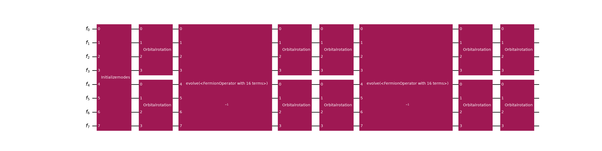
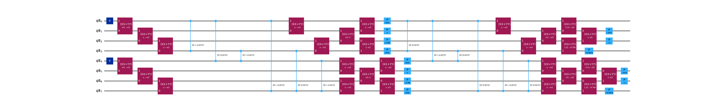
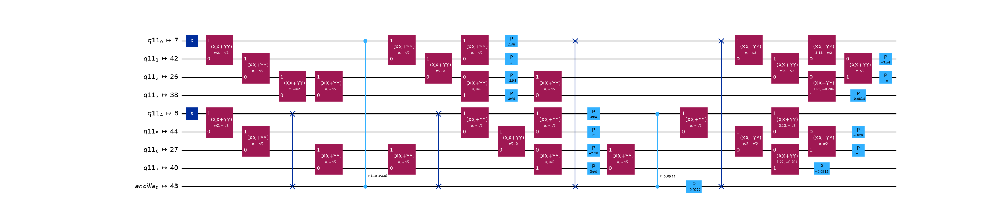

<a id="lucj-transpilation"></a>

# Transpile an LUCJ ansatz

#### IMPORTANT
The concepts in this guide are only available in the Python API.

The local unitary cluster Jastrow ([LUCJ](https://pubs.rsc.org/en/content/articlelanding/2023/sc/d3sc02516k)) ansatz is a compact, hardware-efficient
parametrization of a correlated electronic wavefunction. It is a member of the more
general unitary cluster Jastrow (UCJ) family and takes the form

$$
\lvert \Psi \rangle = \left(\prod_{k=1}^{L} \mathcal{U}_k\, e^{i \mathcal{J}_k}\,
\mathcal{U}_k^\dagger\right) \lvert \Phi_0 \rangle,
$$

where $\lvert \Phi_0 \rangle$ is a reference state (typically Hartree-Fock),
each $\mathcal{U}_k$ is an orbital rotation, and each $\mathcal{J}_k$ is a diagonal
Coulomb operator

$$
\mathcal{J} = \frac12 \sum_{ij,\sigma\tau} \mathbf{J}^{\sigma\tau}_{ij}\,
n_{i\sigma}\, n_{j\tau},
$$

with $n_{i\sigma}$ the number operator on spatial orbital $i$ with spin
$\sigma$.

[ffsim](https://qiskit-community.github.io/ffsim/) builds the ansatz operator; this package turns it into a circuit and lowers that circuit
onto qubits. This guide is about the second half of that sentence. The reason to make the trip is the
lowering itself: ffsim’s own Qiskit gates are specific to the Jordan-Wigner transformation, whereas a
[`FermionicCircuit`](../stubs/qiskit_fermions.circuit.FermionicCircuit.html.md#qiskit_fermions.circuit.FermionicCircuit) carries no assumption about its fermion-to-qubit encoding, so the same
ansatz can be synthesized through whichever encoding suits the target device.

The ansatz operator therefore arrives here ready-made, and everything below is what happens to it
afterwards: what the gate decomposes into, how it lowers through Jordan-Wigner, how it is matched to
a device coupling map, and what a non-Jordan-Wigner lowering would still need. For building,
parametrizing, or simulating a UCJ ansatz in the first place, see ffsim’s
[own guides](https://qiskit-community.github.io/ffsim/how-to-guides/qiskit-lucj.html).

#### SEE ALSO
The [ffsim relationship guide](ffsim.html.md#ffsim-relationship-explanation) for how the two packages
divide the work, and the [transpilation guide](transpilation.html.md#transpilation-explanation) for the pipeline
stages used below.

## 1. Get an LUCJ operator from ffsim

The ansatz is initialized from the amplitudes of a coupled-cluster singles and doubles (CCSD)
calculation. Run restricted Hartree-Fock followed by CCSD for a hydrogen molecule in the `6-31g`
basis, using [PySCF](https://pyscf.org/) for the quantum chemistry, then hand the amplitudes to
ffsim’s [`from_t_amplitudes()`](https://qiskit-community.github.io/ffsim/api/stubs/ffsim.UCJOpSpinBalanced.html#ffsim.UCJOpSpinBalanced.from_t_amplitudes). It performs a *double
factorization* of the $t_2$ amplitudes to obtain the per-layer diagonal Coulomb matrices and
orbital rotations, and derives an optional final orbital rotation from the $t_1$ amplitudes.
The number of repetitions $L$ is whatever that factorization yields; `n_reps` truncates it,
trading accuracy for a shallower circuit.

```pycon
>>> import ffsim
>>> import pyscf
>>> import pyscf.cc
>>>
>>> # build the molecule and run Hartree-Fock
>>> mol = pyscf.gto.Mole()
>>> mol.build(
...     atom=[["H", (0, 0, 0)], ["H", (0, 0, 0.74)]],
...     basis="6-31g",
...     symmetry="Dooh",
...     verbose=0,
... )
<pyscf.gto.mole.Mole object at ...>
>>> scf = pyscf.scf.RHF(mol).run()
>>>
>>> norb = scf.mo_coeff.shape[1]
>>> nelec = (mol.nelec[0], mol.nelec[1])
>>>
>>> # run CCSD for the t-amplitudes, then factorize them into an ansatz operator
>>> ccsd = pyscf.cc.CCSD(scf).run()
>>> t1, t2 = ccsd.t1, ccsd.t2
>>>
>>> ucj_op = ffsim.UCJOpSpinBalanced.from_t_amplitudes(t2, t1=t1, n_reps=2)
```

This is where the ansatz stops being an ffsim concern. ffsim offers choices here that this package
neither sees nor needs to know about, such as the variationally optimized (“compressed”)
factorization behind `optimize=True`, or the parameter-vector packing that a variational optimizer
drives. All of them produce the same kind of operator, and everything below works unchanged on any of
them.

## 2. Turn the operator into a fermionic circuit

The [`UCJ`](../stubs/qiskit_fermions.circuit.library.UCJ.html.md#qiskit_fermions.circuit.library.UCJ) gate wraps the operator and expresses it as a circuit over *fermionic modes*. The
gate is a pure unitary carrying no reference of its own, so prepend an [`InitializeModes`](../stubs/qiskit_fermions.circuit.library.InitializeModes.html.md#qiskit_fermions.circuit.library.InitializeModes) gate
(built with [`from_hartree_fock()`](../stubs/qiskit_fermions.circuit.library.InitializeModes.html.md#qiskit_fermions.circuit.library.InitializeModes.from_hartree_fock)) to supply the
Hartree-Fock reference the ansatz is applied to.

```pycon
>>> from qiskit_fermions.circuit import FermionicCircuit
>>> from qiskit_fermions.circuit.library import InitializeModes, UCJ
>>>
>>> ansatz = UCJ(ucj_op)
>>>
>>> circuit = FermionicCircuit(2 * norb)
>>> circuit.append(InitializeModes.from_hartree_fock(norb, nelec), circuit.modes)
>>> circuit.append(ansatz, circuit.modes)
```

Decomposing the circuit reveals its anatomy, and this is the representation the rest of the guide
operates on. The [`InitializeModes`](../stubs/qiskit_fermions.circuit.library.InitializeModes.html.md#qiskit_fermions.circuit.library.InitializeModes) gate prepares the reference determinant, and each ansatz
layer contributes an [`OrbitalRotation`](../stubs/qiskit_fermions.circuit.library.OrbitalRotation.html.md#qiskit_fermions.circuit.library.OrbitalRotation) $\mathcal{U}_k^\dagger$, then
$e^{i\mathcal{J}_k}$ (an [`Evolution`](../stubs/qiskit_fermions.circuit.library.Evolution.html.md#qiskit_fermions.circuit.library.Evolution) of the diagonal Coulomb operator
$\mathcal{J}_k$), then $\mathcal{U}_k$, with a final [`OrbitalRotation`](../stubs/qiskit_fermions.circuit.library.OrbitalRotation.html.md#qiskit_fermions.circuit.library.OrbitalRotation) at the
end. The orbital rotations act per spin sector, so each is placed on the alpha modes `0..norb` and
the beta modes `norb..2*norb` independently.

```pycon
>>> circuit.decompose().draw("mpl", fold=-1)
<Figure size ... with 1 Axes>
```

([`png`](_downloads/ed5c818557654f5281930d9f7469d8f4/lucj-3.png), [`hires.png`](_downloads/fef80b962e119308964be7a854d7015a/lucj-3.hires.png), [`pdf`](_downloads/1aa501aed21c084b03d7c5d0a4fea9fd/lucj-3.pdf))



Every gate in that decomposition is still fermionic: [`OrbitalRotation`](../stubs/qiskit_fermions.circuit.library.OrbitalRotation.html.md#qiskit_fermions.circuit.library.OrbitalRotation) and
[`Evolution`](../stubs/qiskit_fermions.circuit.library.Evolution.html.md#qiskit_fermions.circuit.library.Evolution) are defined on modes, and no qubit or Pauli operator has appeared yet. That is
what leaves the encoding open, and it is the state the ansatz stays in until the synthesis stage
picks one.

#### NOTE
Each layer ends with $\mathcal{U}_k$ and the next begins with
$\mathcal{U}_{k+1}^\dagger$, so adjacent [`OrbitalRotation`](../stubs/qiskit_fermions.circuit.library.OrbitalRotation.html.md#qiskit_fermions.circuit.library.OrbitalRotation) gates could be merged
into a single rotation. A transpilation pass performing this fusion is a planned future
development.

## 3. Choose a fermion-to-qubit encoding

The circuit is still fermionic, and that is the point at which this package earns its place in the
workflow. A [`FermionicCircuit`](../stubs/qiskit_fermions.circuit.FermionicCircuit.html.md#qiskit_fermions.circuit.FermionicCircuit) carries no assumption about how modes become qubits, so the
encoding is a *synthesis-stage* choice rather than something baked into the ansatz. That is what
this package adds over ffsim’s own Qiskit gates, which are specific to the Jordan-Wigner
transformation.

For Jordan-Wigner alone you would not need this detour: ffsim ships
[`UCJOpSpinBalancedJW`](https://qiskit-community.github.io/ffsim/api/stubs/ffsim.qiskit.UCJOpSpinBalancedJW.html#ffsim.qiskit.UCJOpSpinBalancedJW) and its siblings, which take a UCJ operator to a
qubit circuit on their own. The reason to route the ansatz through a fermionic circuit is everything
*else* an encoding can buy you. Local encodings, for instance, spend extra qubits to bound the Pauli
weight of each term, which the [1D](1d_fermi_hubbard.html.md#d-fermi-hubbard) and [2D](2d_fermi_hubbard.html.md#d-fermi-hubbard)
flow-set guides use to make a Trotter step’s two-qubit depth independent of the system size.

For a UCJ ansatz specifically, the synthesis stage has to cover two kinds of gate:

- **The diagonal Coulomb evolution.** [`Evolution`](../stubs/qiskit_fermions.circuit.library.Evolution.html.md#qiskit_fermions.circuit.library.Evolution) is already encoding-agnostic:
  [`MapperFnEvolutionSynthesis`](../stubs/qiskit_fermions.transpiler.passes.synthesis.MapperFnEvolutionSynthesis.html.md#qiskit_fermions.transpiler.passes.synthesis.MapperFnEvolutionSynthesis) takes a mapper function, so the
  $e^{i \mathcal{J}_k}$ layers lower through any encoding you can express as one. The
  [flow-set guides](1d_fermi_hubbard.html.md#d-fermi-hubbard) show how to write one.
- **Everything else.** The plugins for [`OrbitalRotation`](../stubs/qiskit_fermions.circuit.library.OrbitalRotation.html.md#qiskit_fermions.circuit.library.OrbitalRotation), [`InitializeModes`](../stubs/qiskit_fermions.circuit.library.InitializeModes.html.md#qiskit_fermions.circuit.library.InitializeModes) and
  [`PrepareSlaterDeterminant`](../stubs/qiskit_fermions.circuit.library.PrepareSlaterDeterminant.html.md#qiskit_fermions.circuit.library.PrepareSlaterDeterminant) are not parametrized by an encoding; each documents its
  assumption of an occupation-basis encoding with a 1-to-1 mode-to-qubit mapping, and emits gates
  directly on that basis. A different encoding needs its own plugin for each of these three, and
  none ships yet.

How to transpile UCJ circuits under a non-Jordan-Wigner encoding is an open research question and
this package provides the framework within which to develop such a pipeline.
The remainder of this guide constructs the transpiler pipeline for the Jordan-Wigner encoding,
equivalent to the one produced by [`generate_preset_jw_pass_manager()`](../stubs/qiskit_fermions.transpiler.presets.generate_preset_jw_pass_manager.html.md#qiskit_fermions.transpiler.presets.generate_preset_jw_pass_manager), as an example.

## 4. Lower it through Jordan-Wigner

Lowering happens in [`F2QSynthesis`](../stubs/qiskit_fermions.transpiler.passes.F2QSynthesis.html.md#qiskit_fermions.transpiler.passes.F2QSynthesis), which works like Qiskit’s
[`HighLevelSynthesis`](https://quantum.cloud.ibm.com/docs/api/qiskit/qiskit.transpiler.passes.HighLevelSynthesis): it walks the fermionic instructions
and hands each to a plugin registered for that gate name. Its [`F2QSynthesis.methods`](../stubs/qiskit_fermions.transpiler.passes.F2QSynthesis.html.md#qiskit_fermions.transpiler.passes.F2QSynthesis.methods)
attribute holds one [`F2QSynthesisPlugin`](../stubs/qiskit_fermions.transpiler.passes.synthesis.F2QSynthesisPlugin.html.md#qiskit_fermions.transpiler.passes.synthesis.F2QSynthesisPlugin) per gate name, so building the stage means choosing
a plugin for every fermionic gate the circuit contains:

```pycon
>>> from qiskit_fermions.mappers.library import jordan_wigner
>>> from qiskit_fermions.transpiler.passes import F2QSynthesis
>>> from qiskit_fermions.transpiler.passes.synthesis import (
...     GivensDecompositionOrbitalRotationSynthesis,
...     GivensDecompositionSlaterDeterminantSynthesis,
...     MapperFnEvolutionSynthesis,
...     TrivialOccupationInitializeModesSynthesis,
... )
>>>
>>> synthesis = F2QSynthesis()
>>> synthesis.methods["Evolution"] = MapperFnEvolutionSynthesis(jordan_wigner)
>>> synthesis.methods["InitializeModes"] = TrivialOccupationInitializeModesSynthesis()
>>> synthesis.methods["OrbitalRotation"] = GivensDecompositionOrbitalRotationSynthesis()
>>> synthesis.methods["PrepareSlaterDeterminant"] = (
...     GivensDecompositionSlaterDeterminantSynthesis()
... )
```

Assigning instances like this is also how a plugin you wrote yourself enters the pipeline, without
having to register it anywhere first.

This is where the encoding is settled, in the two ways section 3 described: explicitly, by handing
[`jordan_wigner()`](../stubs/qiskit_fermions.mappers.library.jordan_wigner.html.md#qiskit_fermions.mappers.library.jordan_wigner) to [`MapperFnEvolutionSynthesis`](../stubs/qiskit_fermions.transpiler.passes.synthesis.MapperFnEvolutionSynthesis.html.md#qiskit_fermions.transpiler.passes.synthesis.MapperFnEvolutionSynthesis), and implicitly, by the other three
plugins already assuming it.

That stage then slots into a [`MultiStagePassManager`](https://quantum.cloud.ibm.com/docs/api/qiskit/qiskit.passmanager.MultiStagePassManager) whose
stages run in a fixed order:

```pycon
>>> from qiskit.passmanager import MultiStagePassManager
>>> from qiskit.transpiler import generate_preset_pass_manager
>>>
>>> from qiskit_fermions.transpiler import (
...     FermionicCircuitToDAG,
...     FermionicPassManager,
...     QuantumDAGToCircuit,
... )
>>> from qiskit_fermions.transpiler.passes import (
...     MergeOrbitalRotations,
...     MergeSlaterDeterminantPreparation,
...     TrivialF2QLayout,
... )
>>>
>>> pm = MultiStagePassManager(
...     input=FermionicCircuitToDAG(),
...     optimization=FermionicPassManager(
...         [MergeOrbitalRotations(), MergeSlaterDeterminantPreparation()]
...     ),
...     layout=FermionicPassManager(TrivialF2QLayout()),
...     synthesis=synthesis,
...     qubit=generate_preset_pass_manager(),
...     output=QuantumDAGToCircuit(),
... )
```

The **optimization** stage runs *before* synthesis, on the fermionic circuit, which is what makes it
worth having: it rewrites gates while they are still fermionic and encoding-agnostic, so the savings
carry to whatever encoding follows. [`MergeOrbitalRotations`](../stubs/qiskit_fermions.transpiler.passes.MergeOrbitalRotations.html.md#qiskit_fermions.transpiler.passes.MergeOrbitalRotations) collapses each run of
consecutive [`OrbitalRotation`](../stubs/qiskit_fermions.circuit.library.OrbitalRotation.html.md#qiskit_fermions.circuit.library.OrbitalRotation) gates into one, which matters for a UCJ ansatz because every
layer ends with $\mathcal{U}_k$ and the next begins with $\mathcal{U}_{k+1}^\dagger$.
[`MergeSlaterDeterminantPreparation`](../stubs/qiskit_fermions.transpiler.passes.MergeSlaterDeterminantPreparation.html.md#qiskit_fermions.transpiler.passes.MergeSlaterDeterminantPreparation) then fuses the leading [`InitializeModes`](../stubs/qiskit_fermions.circuit.library.InitializeModes.html.md#qiskit_fermions.circuit.library.InitializeModes) and the
rotation that follows it into a single [`PrepareSlaterDeterminant`](../stubs/qiskit_fermions.circuit.library.PrepareSlaterDeterminant.html.md#qiskit_fermions.circuit.library.PrepareSlaterDeterminant), which synthesis lowers
through the cheaper reduced Slater decomposition instead of a full square rotation. The order
matters: merging the rotations first exposes the single rotation immediately after the
initialization, which the Slater fusion then contracts into it.

The remaining stages are plumbing. `input` and `output` convert between circuits and DAGs,
`layout` assigns fermionic modes to qubits ([`TrivialF2QLayout`](../stubs/qiskit_fermions.transpiler.passes.TrivialF2QLayout.html.md#qiskit_fermions.transpiler.passes.TrivialF2QLayout) maps mode `i` to qubit
`i`), and `qubit` is an ordinary Qiskit pass manager that takes over once nothing fermionic is
left.

Running it requires one preparatory step: the composite [`UCJ`](../stubs/qiskit_fermions.circuit.library.UCJ.html.md#qiskit_fermions.circuit.library.UCJ) gate has to be decomposed
into its primitive gates first, so the optimization stage can see the individual rotations and
evolutions.

```pycon
>>> transpiled = pm.run(circuit.decompose())
>>> print(dict(sorted(transpiled.count_ops().items())))
{'p': 14, 'rzz': 12, 'x': 2, 'xx_plus_yy': 28}
```

Without a target device, this maps onto `2 * norb` qubits with all-to-all connectivity assumed; the
orbital rotations synthesize into [`XXPlusYYGate`](https://quantum.cloud.ibm.com/docs/api/qiskit/qiskit.circuit.library.XXPlusYYGate)objects and the diagonal
Coulomb evolutions into [`RZZGate`](https://quantum.cloud.ibm.com/docs/api/qiskit/qiskit.circuit.library.RZZGate)objects:

```pycon
>>> transpiled.draw("mpl", fold=-1)
<Figure size ... with 1 Axes>
```

([`png`](_downloads/22f5f8f4f539b8e2e15c6e11ebc29b9e/lucj-7.png), [`hires.png`](_downloads/20219a6d5692c829e8b07e920e1776bf/lucj-7.hires.png), [`pdf`](_downloads/9609c59d81814ff54ba5dc6dff48692f/lucj-7.pdf))



This pipeline is exactly what
[`generate_preset_jw_pass_manager()`](../stubs/qiskit_fermions.transpiler.presets.generate_preset_jw_pass_manager.html.md#qiskit_fermions.transpiler.presets.generate_preset_jw_pass_manager) assembles, so reach for
the preset in practice and build the stages by hand when you need to change one of them:

```pycon
>>> from qiskit_fermions.transpiler.presets import generate_preset_jw_pass_manager
>>>
>>> preset = generate_preset_jw_pass_manager()
>>> preset.run(circuit.decompose()).count_ops() == transpiled.count_ops()
True
```

## 5. Match the device topology

A real device has a restricted qubit coupling map, and the LUCJ ansatz is designed to match it. The
same-spin (`pairs_aa`) interactions form two linear chains and the alpha-beta (`pairs_ab`)
interactions bridge them. ffsim’s [`generate_lucj_pass_manager()`](https://qiskit-community.github.io/ffsim/api/stubs/ffsim.qiskit.generate_lucj_pass_manager.html#ffsim.qiskit.generate_lucj_pass_manager) builds a
device-aware qubit pipeline for this structure, and returns the subset of `pairs_ab` the
hardware can actually accommodate. Slot that pipeline into the preset’s `qubit` stage while
keeping the package’s own fermion-to-qubit synthesis:

```pycon
>>> from ffsim.qiskit import generate_lucj_pass_manager
>>> from qiskit.providers.fake_provider import GenericBackendV2
>>> from qiskit.transpiler import CouplingMap
>>>
>>> # a heavy-hex device coupling map (any BackendV2 works, e.g. a real fake_provider backend)
>>> coupling_map = CouplingMap.from_heavy_hex(5)
>>> backend = GenericBackendV2(
...     num_qubits=coupling_map.size(),
...     basis_gates=["cp", "xx_plus_yy", "p", "x", "swap"],
...     coupling_map=coupling_map,
... )
>>>
>>> # nearest-neighbor same-spin chain; let the pass manager choose the alpha-beta pairs
>>> pairs_aa = [(p, p + 1) for p in range(norb - 1)]
>>>
>>> pm = generate_preset_jw_pass_manager()
>>> pm.qubit, allowed_pairs_ab = generate_lucj_pass_manager(
...     backend, norb, "heavy-hex", (pairs_aa, None), optimization_level=3, seed_transpiler=0
... )
>>>
>>> # the alpha-beta interactions the heavy-hex connectivity can implement
>>> print(allowed_pairs_ab)
[(0, 0)]
```

That composition is the point: the `qubit` stage is device-aware, while the fermion-to-qubit
synthesis stage ahead of it stays this package’s own, and so stays replaceable.

With `pm.qubit` now set to the device-aware pipeline, running the pass manager lays the circuit out
on the backend’s qubits and routes it to the coupling map. For the *unrestricted* ansatz from
step 1, whose diagonal Coulomb operator still contains alpha-beta terms the hardware cannot reach
directly, the router must insert many `SWAP` gates to bridge them:

```pycon
>>> naive = pm.run(circuit.decompose())
>>> naive.num_qubits  # laid out on the full heavy-hex device register
57
>>> naive_swaps = naive.count_ops()["swap"]
>>> naive_swaps  # many SWAPs to bridge the unreachable alpha-beta interactions
33
```

### Restrict the ansatz to the hardware-implementable interactions

The fix is to feed `allowed_pairs_ab` back into the ansatz construction, through the
`interaction_pairs` argument of
[`from_t_amplitudes()`](https://qiskit-community.github.io/ffsim/api/stubs/ffsim.UCJOpSpinBalanced.html#ffsim.UCJOpSpinBalanced.from_t_amplitudes), so the diagonal Coulomb operator only
contains alpha-beta terms the coupling map can implement directly. The ansatz then matches the
device topology and the router barely has to touch it:

```pycon
>>> restricted = UCJ(
...     ffsim.UCJOpSpinBalanced.from_t_amplitudes(
...         t2, t1=t1, n_reps=2, interaction_pairs=(pairs_aa, allowed_pairs_ab)
...     )
... )
>>>
>>> circuit = FermionicCircuit(2 * norb)
>>> circuit.append(InitializeModes.from_hartree_fock(norb, nelec), circuit.modes)
>>> circuit.append(restricted, circuit.modes)
>>>
>>> transpiled = pm.run(circuit.decompose())
>>> restricted_swaps = transpiled.count_ops()["swap"]
>>> restricted_swaps  # far fewer routing SWAPs than the unrestricted ansatz
4
```

Drawing only the active qubits (`idle_wires=False`) shows the circuit restricted to the two spin
chains and the alpha-beta bridge, expressed in the device basis gates. Layout and routing scatter the
logical modes across the device’s physical qubits, so pass a `wire_order` taken from the
circuit’s final layout ([`final_index_layout()`](https://quantum.cloud.ibm.com/docs/api/qiskit/qiskit.transpiler.TranspileLayout#final_index_layout) lists the
physical qubit each input qubit ended on, in input-qubit order) to draw the wires back in the
original mode order:

```pycon
>>> wire_order = transpiled.layout.final_index_layout(filter_ancillas=False)
>>> transpiled.draw("mpl", idle_wires=False, fold=-1, wire_order=wire_order)
<Figure size ... with 1 Axes>
```

([`png`](_downloads/bc12a9cf7687843b12cae9571c9b44ff/lucj-12.png), [`hires.png`](_downloads/d13f5f39140dbe724ca5269cd96a0ca9/lucj-12.hires.png), [`pdf`](_downloads/d0191f7d22b3f8cc693d6fc30b535541/lucj-12.pdf))



#### NOTE
The exact post-layout gate counts and depth depend on the routing/optimization passes and the
chosen device, so they are not reproduced here. The key point is the co-design; expressing the
ansatz with a nearest-neighbor `pairs_aa` chain and hardware-filtered `pairs_ab` bridges keeps
the synthesized circuit close to the device topology, minimizing the routing overhead (inserted
`SWAP` gates). See [`GivensDecompositionSlaterDeterminantSynthesis`](../stubs/qiskit_fermions.transpiler.passes.synthesis.GivensDecompositionSlaterDeterminantSynthesis.html.md#qiskit_fermions.transpiler.passes.synthesis.GivensDecompositionSlaterDeterminantSynthesis) for a related
synthesis choice (`minimize_2q_gate_count`), trading two-qubit gate count against routed depth.

## Next steps

- Learn how the individual gates work in the [`qiskit_fermions.circuit.library`](../pydoc/qiskit_fermions.circuit.library.html.md#module-qiskit_fermions.circuit.library)
  documentation and the [fermionic circuit guide](circuit.html.md#fermionic-circuit-explanation).
- Explore the [operators explanation guide](operators.html.md#operators-explanation) to understand how to
  construct fermionic operators and Hamiltonians directly.
- See how a fermionic circuit is mapped to qubits in the
  [transpilation guide](transpilation.html.md#transpilation-explanation).
- Read the [`F2QSynthesis`](../stubs/qiskit_fermions.transpiler.passes.F2QSynthesis.html.md#qiskit_fermions.transpiler.passes.F2QSynthesis) documentation for the other way to configure the synthesis stage:
  a `config` dictionary that selects plugins by the short names they register under their
  `qiskit_fermions.transpiler.synthesis` entry points, rather than by instance.
- Read the [ffsim relationship guide](ffsim.html.md#ffsim-relationship-explanation) to understand how the
  two packages divide the work, and which protocols let ffsim simulate this package’s circuits.
