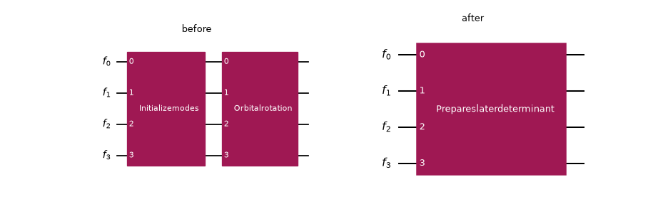
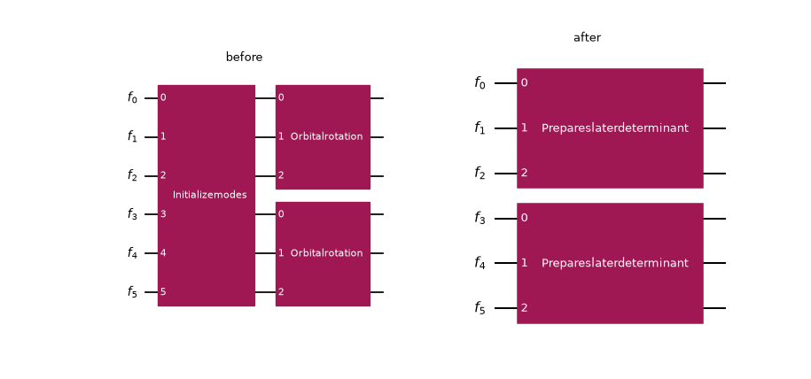
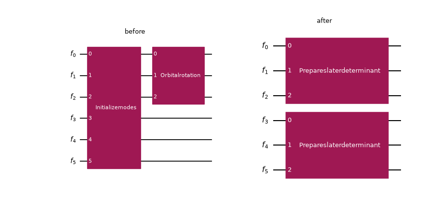
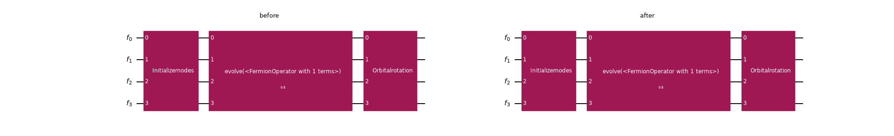
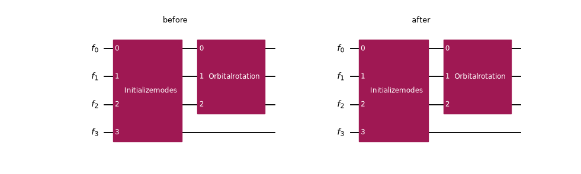
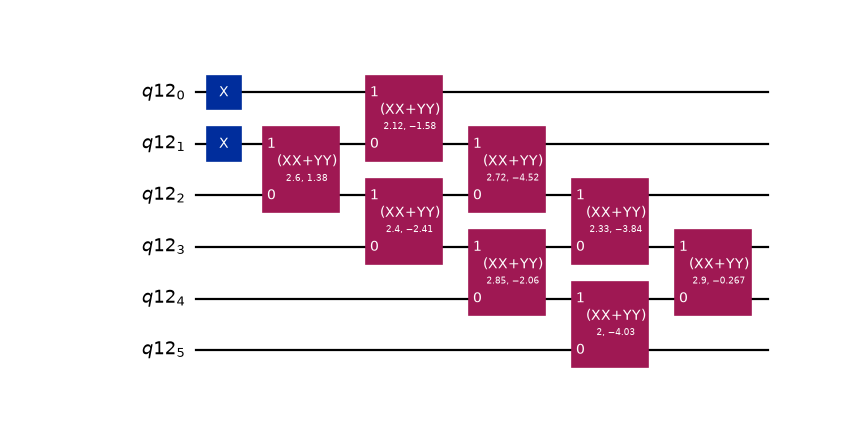
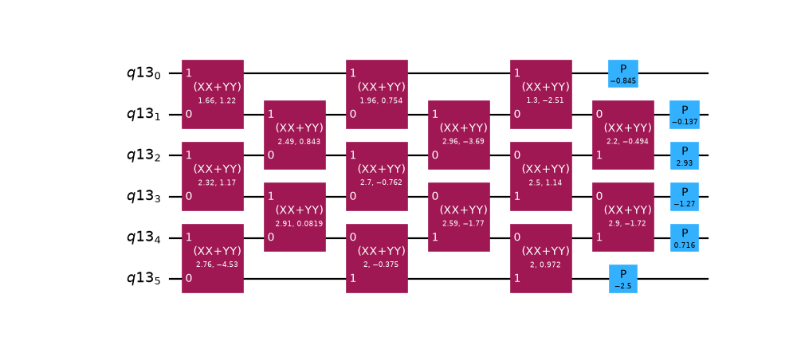

<a id="merge-slater-determinant-explanation"></a>

# Optimize Slater determinant preparation

#### IMPORTANT
The concepts in this guide are currently available only in the Python API.
Equivalent functionality will be made available in the C API in a future release.

An [`InitializeModes`](../stubs/qiskit_fermions.circuit.library.InitializeModes.html.md#qiskit_fermions.circuit.library.InitializeModes) gate declares a reference mode occupation; an
[`OrbitalRotation`](../stubs/qiskit_fermions.circuit.library.OrbitalRotation.html.md#qiskit_fermions.circuit.library.OrbitalRotation) gate rotates the single-particle basis. Placed back to back, the two
gates prepare a *Slater determinant*; the modes start in the reference determinant and are then
rotated into the target orbitals. The [`PrepareSlaterDeterminant`](../stubs/qiskit_fermions.circuit.library.PrepareSlaterDeterminant.html.md#qiskit_fermions.circuit.library.PrepareSlaterDeterminant) gate captures that
composition, and because it carries the reference occupation, transpiling it can use the rectangular
[`givens_decomposition_slater()`](../stubs/qiskit_fermions.linalg.givens_decomposition_slater.html.md#qiskit_fermions.linalg.givens_decomposition_slater), which realizes only the *occupied*
orbitals, instead of the full square decomposition an [`OrbitalRotation`](../stubs/qiskit_fermions.circuit.library.OrbitalRotation.html.md#qiskit_fermions.circuit.library.OrbitalRotation) alone requires. That
is a strictly cheaper synthesis (see the payoff at the end of this guide).

The [`MergeSlaterDeterminantPreparation`](../stubs/qiskit_fermions.transpiler.passes.MergeSlaterDeterminantPreparation.html.md#qiskit_fermions.transpiler.passes.MergeSlaterDeterminantPreparation) transpiler pass detects the
[`InitializeModes`](../stubs/qiskit_fermions.circuit.library.InitializeModes.html.md#qiskit_fermions.circuit.library.InitializeModes)-then-[`OrbitalRotation`](../stubs/qiskit_fermions.circuit.library.OrbitalRotation.html.md#qiskit_fermions.circuit.library.OrbitalRotation) pattern in a [`FermionicCircuit`](../stubs/qiskit_fermions.circuit.FermionicCircuit.html.md#qiskit_fermions.circuit.FermionicCircuit) and
rewrites it into [`PrepareSlaterDeterminant`](../stubs/qiskit_fermions.circuit.library.PrepareSlaterDeterminant.html.md#qiskit_fermions.circuit.library.PrepareSlaterDeterminant) gates, so a later synthesis stage picks up the
reduced decomposition automatically. Under simulation, the rewrite is a no-op on the state:
[`PrepareSlaterDeterminant`](../stubs/qiskit_fermions.circuit.library.PrepareSlaterDeterminant.html.md#qiskit_fermions.circuit.library.PrepareSlaterDeterminant) is *validate-then-rotate* (it validates the reference occupation
and then applies the rotation, just as the two separate gates do), so the merge unlocks the
cheaper synthesis without changing the prepared state.

Throughout this guide, each circuit is drawn before and after the pass, side by side: the input
on the left, and the result of running the pass on it on the right. Two helpers do that. `merge`
runs the pass on a copy of the circuit (through its [`FermionicDAGCircuit`](../stubs/qiskit_fermions.circuit.FermionicDAGCircuit.html.md#qiskit_fermions.circuit.FermionicDAGCircuit)) and converts the
result back to a drawable [`FermionicCircuit`](../stubs/qiskit_fermions.circuit.FermionicCircuit.html.md#qiskit_fermions.circuit.FermionicCircuit), and `draw_merge` draws both halves into a
single before/after figure:

```pycon
>>> import matplotlib.pyplot as plt
>>> import numpy as np
>>>
>>> from qiskit_fermions.circuit import FermionicCircuit
>>> from qiskit_fermions.circuit.library import InitializeModes, OrbitalRotation
>>> from qiskit_fermions.transpiler import FermionicCircuitToDAG
>>> from qiskit_fermions.transpiler.converters import FermionicDAGToCircuit
>>> from qiskit_fermions.transpiler.passes import MergeSlaterDeterminantPreparation
>>>
>>> def merge(circuit):
...     dag = FermionicCircuitToDAG().run(circuit)
...     merged = MergeSlaterDeterminantPreparation().run(dag)
...     return FermionicDAGToCircuit().run(merged)
>>>
>>> def natural_size(circuit):
...     # the figure size Qiskit picks for a circuit on its own (discard the probe figure)
...     probe = circuit.draw("mpl")
...     size = probe.get_size_inches()
...     plt.close(probe)
...     return size
>>>
>>> def draw_merge(circuit):
...     merged = merge(circuit)
...     # let Qiskit size each half naturally, then lay them out side by side
...     (bw, bh), (aw, ah) = natural_size(circuit), natural_size(merged)
...     fig, (before, after) = plt.subplots(1, 2, figsize=(bw + aw, max(bh, ah)))
...     circuit.draw("mpl", ax=before)
...     merged.draw("mpl", ax=after)
...     before.set_title("before")
...     after.set_title("after")
...     return fig
```

## What gets merged

The pass recognizes three patterns, all keyed off the block-spin mode convention that
[`InitializeModes`](../stubs/qiskit_fermions.circuit.library.InitializeModes.html.md#qiskit_fermions.circuit.library.InitializeModes) and [`OrbitalRotation`](../stubs/qiskit_fermions.circuit.library.OrbitalRotation.html.md#qiskit_fermions.circuit.library.OrbitalRotation) use. For a system with `norb` spatial
orbitals, the modes `0..norb` are the spin-alpha sector, and `norb..2*norb` are the spin-beta
sector. Slater determinant preparation is done per spin sector because each sector has its own
(electrons, orbitals) shape.

### Full-register (or spinless)

The simplest pattern is using [`InitializeModes`](../stubs/qiskit_fermions.circuit.library.InitializeModes.html.md#qiskit_fermions.circuit.library.InitializeModes), immediately followed by an
[`OrbitalRotation`](../stubs/qiskit_fermions.circuit.library.OrbitalRotation.html.md#qiskit_fermions.circuit.library.OrbitalRotation) on the *same* modes. This is the spinless case (one determinant over all
modes) and also a spinful circuit whose rotation spans both sectors at once. The two gates fuse into
a single [`PrepareSlaterDeterminant`](../stubs/qiskit_fermions.circuit.library.PrepareSlaterDeterminant.html.md#qiskit_fermions.circuit.library.PrepareSlaterDeterminant):

```pycon
>>> circuit = FermionicCircuit(4)
>>> circuit.append(InitializeModes([1, 1, 0, 0]), circuit.modes)
>>> circuit.append(OrbitalRotation(np.eye(4)), circuit.modes)
>>> draw_merge(circuit)
<Figure size ... with 2 Axes>
```

([`png`](_downloads/860ca1fe2ddb95d8b795a7f512b6578d/merge_slater_determinant-2.png), [`hires.png`](_downloads/98e41e1c3ef5f70becd24a43233cda6d/merge_slater_determinant-2.hires.png), [`pdf`](_downloads/104ee0530414a88faed1d3d53f7eccc5/merge_slater_determinant-2.pdf))



### Per spin sector

This is the same shape, but restricted to one spin half. Here, two independent initialize-then-rotate pairs, one
per sector each fuse on their own into a [`PrepareSlaterDeterminant`](../stubs/qiskit_fermions.circuit.library.PrepareSlaterDeterminant.html.md#qiskit_fermions.circuit.library.PrepareSlaterDeterminant):

```pycon
>>> circuit = FermionicCircuit(6)  # norb = 3: alpha modes 0..3, beta modes 3..6
>>> circuit.append(InitializeModes([1, 1, 0]), circuit.modes[:3])
>>> circuit.append(OrbitalRotation(np.eye(3)), circuit.modes[:3])
>>> circuit.append(InitializeModes([1, 0, 0]), circuit.modes[3:])
>>> circuit.append(OrbitalRotation(np.eye(3)), circuit.modes[3:])
>>> draw_merge(circuit)
<Figure size ... with 2 Axes>
```

([`png`](_downloads/890c4f6eb444345134563ca776c2ac07/merge_slater_determinant-3.png), [`hires.png`](_downloads/da61760163934a7fc369f8a9813c5231/merge_slater_determinant-3.hires.png), [`pdf`](_downloads/50da7c1682224b15e84d850379ab2c1a/merge_slater_determinant-3.pdf))


### Global initialization, per-spin rotations

This entails a single full-register (`2 * norb`) [`InitializeModes`](../stubs/qiskit_fermions.circuit.library.InitializeModes.html.md#qiskit_fermions.circuit.library.InitializeModes) followed by *two*
[`OrbitalRotation`](../stubs/qiskit_fermions.circuit.library.OrbitalRotation.html.md#qiskit_fermions.circuit.library.OrbitalRotation)actions, one on each contiguous spin half. The pass splits the global
occupation at the sector boundary and emits **two** [`PrepareSlaterDeterminant`](../stubs/qiskit_fermions.circuit.library.PrepareSlaterDeterminant.html.md#qiskit_fermions.circuit.library.PrepareSlaterDeterminant) gates. The
two rotations might appear in either order.

This is the shape produced by the local unitary cluster Jastrow (LUCJ) workflow (see the
[LUCJ guide](lucj.html.md#lucj-transpilation));
A user places an [`InitializeModes`](../stubs/qiskit_fermions.circuit.library.InitializeModes.html.md#qiskit_fermions.circuit.library.InitializeModes) (typically the Hartree-Fock reference by using
[`from_hartree_fock()`](../stubs/qiskit_fermions.circuit.library.InitializeModes.html.md#qiskit_fermions.circuit.library.InitializeModes.from_hartree_fock)) at the front of the
circuit and appends a [`UCJ`](../stubs/qiskit_fermions.circuit.library.UCJ.html.md#qiskit_fermions.circuit.library.UCJ) ansatz, whose first two per-spin orbital rotations directly
follow the initialization once the ansatz is decomposed.

```pycon
>>> circuit = FermionicCircuit(6)  # norb = 3, nelec = (2, 1)
>>> circuit.append(InitializeModes.from_hartree_fock(3, (2, 1)), circuit.modes)
>>> circuit.append(OrbitalRotation(np.eye(3)), circuit.modes[:3])
>>> circuit.append(OrbitalRotation(np.eye(3)), circuit.modes[3:])
>>> draw_merge(circuit)
<Figure size ... with 2 Axes>
```

([`png`](_downloads/f1919811e3f1ca94f2f7fc20367226e4/merge_slater_determinant-4.png), [`hires.png`](_downloads/4028627572eabe4b2fd990c1422cbc60/merge_slater_determinant-4.hires.png), [`pdf`](_downloads/a8b31156841f288f3aee3b03f88dceb1/merge_slater_determinant-4.pdf))



This pattern also fires when only *one* spin half is rotated by a gate directly following the
initialization, the shape produced when just one spin sector’s orbital rotation happens to sit at
the front of the circuit. The rotated half becomes a [`PrepareSlaterDeterminant`](../stubs/qiskit_fermions.circuit.library.PrepareSlaterDeterminant.html.md#qiskit_fermions.circuit.library.PrepareSlaterDeterminant) with its
rotation, and the other half is prepared with an *identity* rotation. The identity preparation
synthesizes to the reference X gates that the [`InitializeModes`](../stubs/qiskit_fermions.circuit.library.InitializeModes.html.md#qiskit_fermions.circuit.library.InitializeModes) would have
emitted for that half anyway, so padding it costs no extra gates while still unlocking the reduced
Slater synthesis on the rotated half:

```pycon
>>> circuit = FermionicCircuit(6)
>>> circuit.append(InitializeModes.from_hartree_fock(3, (2, 1)), circuit.modes)
>>> circuit.append(OrbitalRotation(np.eye(3)), circuit.modes[:3])
>>> draw_merge(circuit)
<Figure size ... with 2 Axes>
```

([`png`](_downloads/fc026598e206e06d3ec58c0e9ca6222a/merge_slater_determinant-5.png), [`hires.png`](_downloads/945c774ee046a9aecf5356fddd704ffa/merge_slater_determinant-5.hires.png), [`pdf`](_downloads/ac8d429fbad3b86249c3243a143bdc74/merge_slater_determinant-5.pdf))



## What is left untouched

The pass is deliberately conservative. It only fuses when the two gates genuinely compose into a
Slater determinant preparation, and copies everything else through unchanged. “Immediately
followed” is understood over the circuit’s data-flow graph. The [`OrbitalRotation`](../stubs/qiskit_fermions.circuit.library.OrbitalRotation.html.md#qiskit_fermions.circuit.library.OrbitalRotation) fuses
only when the [`InitializeModes`](../stubs/qiskit_fermions.circuit.library.InitializeModes.html.md#qiskit_fermions.circuit.library.InitializeModes) is its *sole* predecessor across all of its modes. In the
figures below, the before and after are identical: nothing fused.

### An operation in between

If any gate touches the modes between the initialization and the rotation, they no longer compose
into a bare preparation, so nothing is merged:

```pycon
>>> from qiskit_fermions.circuit.library import Evolution
>>> from qiskit_fermions.operators import FermionOperator, ann, cre
>>>
>>> circuit = FermionicCircuit(4)
>>> circuit.append(InitializeModes([1, 1, 0, 0]), circuit.modes)
>>> number_op = FermionOperator.from_dict({(cre(0), ann(0)): 1.0})
>>> circuit.append(Evolution(4, number_op, time=0.5), circuit.modes)
>>> circuit.append(OrbitalRotation(np.eye(4)), circuit.modes)
>>> draw_merge(circuit)
<Figure size ... with 2 Axes>
```

([`png`](_downloads/33104b2b1c8d55a88b03b9884d03dde1/merge_slater_determinant-6.png), [`hires.png`](_downloads/7c674d329d5b9f0a17374cb6d711b424/merge_slater_determinant-6.hires.png), [`pdf`](_downloads/80fc8a08053311f9ab0083e9e63f2658/merge_slater_determinant-6.pdf))



### A partial rotation that is not a spin half

A rotation covering exactly one contiguous spin half of a full-register initialization *does* fuse
(see the previous section). But a rotation on any *other* partial mode set (fewer modes than the
initialization and not one of its two spin halves, such as a sub-range straddling the sector
boundary) is not a per-sector preparation. Merging it would silently drop the initialization’s
role on the modes it leaves out, so the pass leaves both gates in place:

```pycon
>>> circuit = FermionicCircuit(4)  # norb = 2: the only spin halves are modes [0, 1] and [2, 3]
>>> circuit.append(InitializeModes([1, 1, 0, 0]), circuit.modes)
>>> circuit.append(OrbitalRotation(np.eye(3)), circuit.modes[:3])
>>> draw_merge(circuit)
<Figure size ... with 2 Axes>
```

([`png`](_downloads/39402215546f67841bd7786e41c95b50/merge_slater_determinant-7.png), [`hires.png`](_downloads/e3d62c1fa445d879bd9b94ecb40dbe11/merge_slater_determinant-7.hires.png), [`pdf`](_downloads/fbcc0f752f70b60ce25707861a6e88e9/merge_slater_determinant-7.pdf))



## Why it matters: the synthesis payoff

The merge is worthwhile because [`PrepareSlaterDeterminant`](../stubs/qiskit_fermions.circuit.library.PrepareSlaterDeterminant.html.md#qiskit_fermions.circuit.library.PrepareSlaterDeterminant) synthesizes to far fewer gates
than the [`OrbitalRotation`](../stubs/qiskit_fermions.circuit.library.OrbitalRotation.html.md#qiskit_fermions.circuit.library.OrbitalRotation) it absorbs. An $m$-electron determinant over $n$
orbitals needs at most $m(n-m)$ two-qubit rotations and no diagonal phase gates, versus the
$n(n-1)/2$ rotations plus $n$ phases of the full square orbital rotation.

The preset Jordan-Wigner pass manager runs [`MergeSlaterDeterminantPreparation`](../stubs/qiskit_fermions.transpiler.passes.MergeSlaterDeterminantPreparation.html.md#qiskit_fermions.transpiler.passes.MergeSlaterDeterminantPreparation) in its
optimization stage, so this reduction happens automatically. Transpile a two-electron,
six-orbital preparation all the way to a [`QuantumCircuit`](https://quantum.cloud.ibm.com/docs/api/qiskit/qiskit.circuit.QuantumCircuit) and count its gates:

#### NOTE
The preset runs [`MergeOrbitalRotations`](../stubs/qiskit_fermions.transpiler.passes.MergeOrbitalRotations.html.md#qiskit_fermions.transpiler.passes.MergeOrbitalRotations) immediately before
[`MergeSlaterDeterminantPreparation`](../stubs/qiskit_fermions.transpiler.passes.MergeSlaterDeterminantPreparation.html.md#qiskit_fermions.transpiler.passes.MergeSlaterDeterminantPreparation). This matters when a *run* of consecutive
[`OrbitalRotation`](../stubs/qiskit_fermions.circuit.library.OrbitalRotation.html.md#qiskit_fermions.circuit.library.OrbitalRotation) gates follows the initialization. The earlier pass first collapses the
run into a single rotation, which [`MergeSlaterDeterminantPreparation`](../stubs/qiskit_fermions.transpiler.passes.MergeSlaterDeterminantPreparation.html.md#qiskit_fermions.transpiler.passes.MergeSlaterDeterminantPreparation) then contracts with
the initialization into one [`PrepareSlaterDeterminant`](../stubs/qiskit_fermions.circuit.library.PrepareSlaterDeterminant.html.md#qiskit_fermions.circuit.library.PrepareSlaterDeterminant). Without that ordering, only the
first rotation of the run would be absorbed and the rest would synthesize with the full square
decomposition.

```pycon
>>> from qiskit_fermions.transpiler.presets import generate_preset_jw_pass_manager
>>>
>>> # a reproducible random 6 x 6 orbital rotation
>>> rng = np.random.default_rng(1)
>>> z = rng.standard_normal((6, 6)) + 1j * rng.standard_normal((6, 6))
>>> q, r = np.linalg.qr(z)
>>> rotation = q * (np.diagonal(r) / np.abs(np.diagonal(r)))
>>>
>>> circuit = FermionicCircuit(6)
>>> circuit.append(InitializeModes([1, 1, 0, 0, 0, 0]), circuit.modes)
>>> circuit.append(OrbitalRotation(rotation), circuit.modes)
>>>
>>> pm = generate_preset_jw_pass_manager()
>>> prepared = pm.run(circuit)
>>> print(dict(sorted(prepared.count_ops().items())))
{'x': 2, 'xx_plus_yy': 8}
```

```pycon
>>> prepared.draw("mpl", fold=-1)
<Figure size ... with 1 Axes>
```

([`png`](_downloads/0a58e2bcef19b35adc9f74d7e8b0d52a/merge_slater_determinant-9.png), [`hires.png`](_downloads/721c1bc4d2a5f237f3ec08650bd67859/merge_slater_determinant-9.hires.png), [`pdf`](_downloads/65246c7532684c97d59f941d8438460d/merge_slater_determinant-9.pdf))



Compare that to synthesizing the same orbital rotation on its own. With no preceding
initialization there is nothing to merge, so the preset falls back to the full square
decomposition, which is deeper and carries diagonal phase gates:

```pycon
>>> reference = FermionicCircuit(6)
>>> reference.append(OrbitalRotation(rotation), reference.modes)
>>> reference_prepared = pm.run(reference)
>>> print(dict(sorted(reference_prepared.count_ops().items())))
{'p': 6, 'xx_plus_yy': 15}
```

```pycon
>>> reference_prepared.draw("mpl", fold=-1)
<Figure size ... with 1 Axes>
```

([`png`](_downloads/6ca3d8da32d7653f4a65ed7289446267/merge_slater_determinant-11.png), [`hires.png`](_downloads/5153b2603f5796deab11a876e07d1256/merge_slater_determinant-11.hires.png), [`pdf`](_downloads/7c9273aad271983de908dfa125a3246f/merge_slater_determinant-11.pdf))



The reduced decomposition drops all six phase gates and nearly halves the two-qubit rotation count.
The prepared determinant is correct up to a global phase (physically irrelevant for state
preparation), which is what the phase gates would have fixed.

#### SEE ALSO
[`PrepareSlaterDeterminant`](../stubs/qiskit_fermions.circuit.library.PrepareSlaterDeterminant.html.md#qiskit_fermions.circuit.library.PrepareSlaterDeterminant), [`InitializeModes`](../stubs/qiskit_fermions.circuit.library.InitializeModes.html.md#qiskit_fermions.circuit.library.InitializeModes), [`OrbitalRotation`](../stubs/qiskit_fermions.circuit.library.OrbitalRotation.html.md#qiskit_fermions.circuit.library.OrbitalRotation),
[`MergeOrbitalRotations`](../stubs/qiskit_fermions.transpiler.passes.MergeOrbitalRotations.html.md#qiskit_fermions.transpiler.passes.MergeOrbitalRotations),
[`GivensDecompositionSlaterDeterminantSynthesis`](../stubs/qiskit_fermions.transpiler.passes.synthesis.GivensDecompositionSlaterDeterminantSynthesis.html.md#qiskit_fermions.transpiler.passes.synthesis.GivensDecompositionSlaterDeterminantSynthesis), and the
[LUCJ guide](lucj.html.md#lucj-transpilation) for the workflow that produces the global-initialization
pattern.
